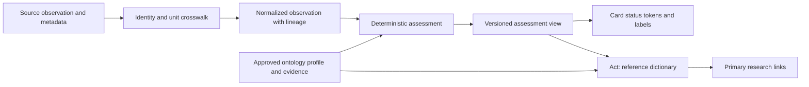

# Proposal: ontology-driven measurement attention and reference dictionary

Date: 2026-10-22 (America/Chicago). Status: **proposed; not ratified or implemented**.
Origin: Nate's request for measurement-driven card color, explainable thresholds, US-first units and self-service research.
Planning work: DOC-7 and W-96–W-100 in the [platform WSJF backlog](../backlog.md).
This proposal is the canonical design discussion; scoring lives only in the backlog. No code, production thresholds, automation or deployment is authorized by this document.

## 1. Product outcome and scope

A person sees an air-quality reading, immediately recognizes whether it needs attention, selects **Act → Understand this measurement**, sees exactly how the label was determined, then follows primary sources to investigate independently. A good reading should be reassuring; an unfavorable reading should be conspicuous and explainable. “Great” is permitted only where an approved profile defines it; do not invent a superior health category inside an authority's “Good” range.

First slice: one explicitly identified US AQI feed plus a temperature conversion fixture. Follow with additional measurements and jurisdictions after evidence and adapter review. AQI is an index, not ppm or a universal air-quality unit. CO2, CO, VOC, particulate concentration and a manufacturer's composite air score are distinct concepts. An indoor instantaneous sensor value must not silently acquire an outdoor daily AQI interpretation.

The UI's measurement status comes entirely from an approved, versioned assessment contract. Themes own accessible colors; ontology policy owns semantic meaning. Device connectivity, alert state and measurement attention remain independently visible. Recommendations generated in-app, external search integration and device action execution are later product work.

## 2. Current baseline and reuse

Inspected GitHub main tree `e68dea60e37de2723eb7fcac35e0ad338d7a2896`; source inspection is not live verification.

| Existing home | Evidence and proposed treatment |
|---|---|
| [ontology.yaml](../../ontology.yaml) | Semantic contract with canonical IDs, audience rendering, relation cardinality, transformation and four `normal_range` blocks. Temperature already stores °C and displays °F by default. Battery and humidity already describe warn/critical behavior. Existing prose ranges do not provide a uniform source/version/applicability contract. Preserve them pending explicit reconciliation; do not automatically convert them into approved policies. |
| [D7/D13/D15/D16/D27](../decisions/ontology-decisions.md) | Reuse service identity, measurement type, reporting topic and subject relations. Topic membership grants neither a threshold nor control capability. D16's computed reporting topic remains unchanged. |
| [DeviceReportingRelationship](../../../cabin-orchestration-platform/backend/src/main/java/com/cabin/orchestrator/devices/model/DeviceReportingRelationship.java) | Existing service identity is deviceId + semanticField; measurementType and curated displayLabel exist. Bind profiles to this identity through canonical measurement definitions, not device-name matching. |
| [OntologyLookupService](../../../cabin-orchestration-platform/backend/src/main/java/com/cabin/orchestrator/ontology/OntologyLookupService.java) | Currently returns ID, display name, entity type and found status, with a humanized fallback. Extend through a reviewed additive contract; this is not an assessment engine or complete dictionary today. Missing ontology cannot imply a successful assessment. |
| [DeviceDisplayConfig](../../../cabin-orchestration-platform/backend/src/main/java/com/cabin/orchestrator/devices/display/DeviceDisplayConfig.java) | Existing severityOverride can force OK/WARN/ALERT. Future measurement attention must not be overwritten by this profile setting. Audit callers and define compatibility before changing behavior; no override is removed in this PR. |
| [AlertSeverityClassifier](../../../cabin-orchestration-platform/backend/src/main/java/com/cabin/orchestrator/events/AlertSeverityClassifier.java) | Existing event classifier is separate. Measurement attention does not suppress, replace or create safety alerts automatically. |
| [UX Journey Standard](../../UX_JOURNEY_STANDARD.md) | Reuse See → Think → Act → Recover, theme tokens, structural/status color separation, keyboard/focus and return-context requirements. |

## 3. Architecture and ownership

Keep raw observations immutable. A backend assessment function selects exactly one applicable approved profile, validates comparability and freshness, normalizes into that profile's comparison unit, and produces an explanation with versioned lineage. Reuse telemetry and ontology loading; do not introduce a second ingestion or alert engine. UI formatting can change units without changing the assessment.

Proposed implementation shape: small typed policy records sourced from Git, validated at load/build time, an assessment service, an additive assessment response, and shared UI presentation rules usable by React and the static Family Hub. Use the existing API/security patterns after caller inventory; endpoint paths and storage migrations are intentionally undecided. Pin policy version per response; atomically load the dictionary and evaluator from the same approved bundle. Invalid bundles retain the prior valid version with visible version/freshness metadata, or return unavailable if none exists.

The ontology defines meaning and links; schema defines structure; evaluator defines execution; theme defines accessible presentation. No browser-side threshold copies, model-selected severity, or hard-coded component ranges.

## 4. Proposed ontology classes and fields

Names below are candidate vocabulary, not allocated production ontology IDs. Add linked classes/records rather than expanding every element into a sparse wide table. The dictionary may flatten these into columns for inspection. Reconcile names against the complete vocabulary before ratification.

| Proposed class | Required fields / constraints |
|---|---|
| MeasurementDefinition | Stable ID, ontology element reference, quantity kind, analyte/species, definition, scalar/categorical/vector shape, datatype, direction (higher-worse/lower-worse/two-sided/categorical), valid domain, context requirements, primary US display and secondary SI/international display, dictionary reference. |
| UnitDefinition | Stable unit code, symbol, dimension, quantity kind, basis (mass/volume/mole fraction/index), standard reference conditions if applicable. Unitless index carries named scheme/version. “ppm” alone is insufficient when basis is ambiguous. |
| ReportingCrosswalk | Source system/model/firmware + semantic field, target measurement ID, source unit/basis, source method and averaging window, mapping status (exact/conditional/lossy/unmappable), transform ID/version, required metadata, precision and uncertainty policy. No fuzzy field-name equivalence. |
| ThresholdProfile | ID/version, measurement ID, jurisdiction, indoor/outdoor/use context, population applicability, purpose (health guidance/comfort/device operation/empirical anomaly), comparison unit, method/window, minimum coverage, freshness limit, effective dates, evidence references, approval state/owner/reviewer and review-due date. |
| ThresholdBand | Profile ID, ordinal, bounds and inclusive flags or categorical set, native category, attention level, optional score, semantic status token, explanation; all supported values must resolve deterministically, with explicit out-of-domain handling. |
| EvidenceRecord | Publisher/title/URL/section, source revision/publication and retrieval dates, scope, claim supported, quoted extract location or approved snapshot/hash where permitted, provenance kind, derivation ID, uncertainty/limitations, curator, review state and supersession link. |
| DerivationRecord | Method/formula/code revision, input evidence and dataset versions/hashes, filters, units, context, sampling period, sample size, missingness, exclusions, statistics and validation report. Corpus chunks link to their authoritative source; retrieval rank is not evidence authority. |
| ObservationAssessment | Observation/service/measurement IDs, observedAt/receivedAt/evaluatedAt, raw value/unit, normalized value/unit, method/window, quality flags, profile/version, band, attention, optional score, conversion lineage, reason code, dictionary/version and source references. |

### Cardinality and identity

- One device has many reporting services; one service has many observations over time. Each scalar observation resolves to exactly one measurement definition. Split vector or multi-analyte payloads into traceable components before assessment.
- One measurement has many context-specific profiles and many source crosswalks. Each crosswalk targets one measurement definition; multiple sources can map to that definition without merging their observations.
- One profile has one or more bands and one or more evidence records. Evidence may support many profiles (N:M). A profile/version plus band ordinal is unique.
- One observation can have several explicitly requested assessments for different purposes/populations; each assessment selects exactly one profile/version. Its displayed primary purpose must be explicit. Equally specific conflicting profiles produce unknown/ambiguous, not “first row wins.”
- One definition has one dictionary entry with many localized renderings. Entries link to many sources and crosswalks. A card with many measurements references each assessment; never average unlike units or severity values.
- Location, room, device and service IDs remain stable; policy updates create new versions. Replays retain the original assessment or explicitly label recalculation under a newer profile.

### Deterministic attention contract

`attention = low | medium | high | unknown`. Low means little attention needed, not a low measurement value. Keep `native_category` and `quality_state` separate. A continuous universal “criticality score” would imply unsupported comparability across hazards. First release uses ordinal scores **0/1/2** for low/medium/high only if a consumer needs numeric sorting; unknown has null score and its own visible queue. These numbers are not probabilities, exposure estimates or comparable risk magnitudes. Richer within-profile scoring requires a reviewed formula and calibration.

Selection order: required measurement/scheme → compatible jurisdiction/context/purpose/population → method/window/unit basis → approved effective version → declared specificity. Missing required metadata, expired evidence review, incompatible mapping, stale/invalid observation or conflicting applicable profiles yields unknown with reason. Review expiry must be explicit policy, not an undocumented date heuristic.

Evaluate before display rounding. Every boundary has explicit inclusion and precision rules. Support lower-is-worse, higher-is-worse, two-sided and categorical bands. Missing, NaN, impossible values, missing units and out-of-domain results never default to low. “Unknown” does not erase a last-known high result: show its time and “last known high; current unavailable.” Hysteresis may stabilize presentation only if a versioned profile defines clear/recovery behavior; show current band and held attention separately and never delay initial high attention.

## 5. Units, federation and mastering

US-first is a presentation preference, not a universal change to scientific storage units or jurisdiction. Show °F first and °C second for US temperature; preserve °C source and canonical comparison values. For AQI show the named index and source scheme, not a fabricated US customary unit. International display uses SI where applicable and a named jurisdiction-specific index where relevant; there is no single international AQI.

- Absolute temperature: °F = °C × 9/5 + 32; intervals use the scale factor only. Example: 20 °C → 68 °F. A unit preference must leave band/attention invariant. [NIST temperature reference](https://www.nist.gov/pml/owm/si-units-temperature).
- For the same gas and explicitly matched volume basis, ppmv × 1000 = ppbv. Preserve wet/dry basis and reference conditions. Gas volume fraction to mass concentration requires species/molecular mass, temperature, pressure and an approved method; absent inputs mean incomparable. PM mass concentration cannot be converted to gaseous ppm by a generic multiplier. [NSW EPA measurement toolkit, sections 1.3–1.4](https://www.epa.nsw.gov.au/sites/default/files/240164localgovernmentairqualitytoolkitmodule1scienceairqualitypart3measurairquality.pdf).
- AQI conversion is a named pollutant/method/window-specific derivation using the adopted breakpoint revision and preprocessing rules. A daily average, an instantaneous concentration and a NowCast are not interchangeable. Different national indexes require separate schemes; do not use a linear index-to-index crosswalk.
- Keep original field, value, unit, timestamp, device method and provider alongside the canonical observation. Deduplicate only with verified event identity; retain source-specific uncertainty and conflicting readings. Never average two sensors solely because they map to the same measurement.
- Master definitions and source aliases through reviewed crosswalks. Record exact/conditional/lossy/unmappable status in the dictionary. Unknown units are a curation gap, not an invitation to guess.

## 6. Research and reference-range governance

Evidence precedence for the same applicable purpose: relevant current primary authority/standard → validated device-method documentation → peer-reviewed evidence → approved empirical derivation → explicitly labeled local preference. Scope outranks prestige: outdoor public-health guidance is not automatically indoor sensor guidance; occupational limits are not household comfort targets. Preserve competing guidance with context rather than blending it into a universal average.

Research procedure: inventory actual source metadata and existing ranges; identify the precise quantity and decision purpose; collect primary sources with versions and applicability; reconcile disagreements; encode boundaries/window/method; validate conversion and examples; domain review plus Nate's ratification; publish a versioned bundle and dictionary together. Review on source revision, changed sensor method, new jurisdiction, dataset drift or review-due date.

Datasets/corpus may support an empirical baseline only when provenance, coverage, missingness, sampling bias and validation are recorded. Percentiles can define “unusual for this room,” not “safe” or “healthy.” Research-derived and dataset-derived thresholds remain proposals until reviewed; an LLM may locate or summarize evidence but never self-approve an operational range.

### Researched pilot evidence (accessed 2026-10-22)

| Source | Supported use | Limits / next evidence needed |
|---|---|---|
| [AirNow AQI basics](https://www.airnow.gov/aqi/aqi-basics/) | Six official concern categories and index ranges; retain them in dictionary and badge. | Public AQI interpretation, not proof of indoor sensor equivalence. |
| [EPA AQS breakpoint table](https://aqs.epa.gov/aqsweb/documents/codetables/aqi_breakpoints.html) (page dated October 21, 2026) | Pollutant and duration-specific breakpoints; PM2.5 24-hour Good concentration range 0.0–9.0, Moderate 9.1–35.4. | Units/method/preprocessing must be confirmed in the adopted technical method before concentration-to-AQI implementation. Table alone is insufficient. Do not import its database sentinels as unlimited healthy/valid values. |
| [AirNow using AQI](https://www.airnow.gov/aqi/aqi-basics/using-air-quality-index/) | Current AirNow air quality uses NowCast; temporal semantics must accompany the reading. | Actual chosen provider's reporting method and metadata remain to be inventoried. |
| [NIST temperature reference](https://www.nist.gov/pml/owm/si-units-temperature) | Exact temperature scale conversion. | Does not establish comfort or freeze thresholds. |
| [NSW EPA measurement toolkit](https://www.epa.nsw.gov.au/sites/default/files/240164localgovernmentairqualitytoolkitmodule1scienceairqualitypart3measurairquality.pdf), July 2024, sections 1.3–1.4 | Distinguishes mass/volume concentration and required gas conversion conditions. | Does not authorize a particular sensor crosswalk or household threshold. |

Illustrative US AQI attention profile for **integer, valid provider-reported US AQI**:

| AQI | Native category | Proposed attention | Proposed status token |
|---|---|---|---|
| 0–50 | Good | low | positive |
| 51–100 | Moderate | medium | caution |
| 101–150 | Unhealthy for Sensitive Groups | high | danger |
| 151–200 | Unhealthy | high | danger |
| 201–300 | Very Unhealthy | high | danger |
| 301–500 | Hazardous | high | danger |

The category boundaries come from AirNow; the three attention levels and tokens are **our proposed UX mapping**, not EPA classifications. Preserve all six native categories and an official category legend even when card emphasis collapses them. Above 500: high/out-of-scale with explanation, never clamp to Good; invalid negatives: unknown. Fractional AQI needs a provider-defined preprocessing rule; do not silently round. Sensitive-population profiles may be more conservative and must be separately reviewed. No approved “Great” sub-band is asserted.

## 7. Ontology ↔ UX contract

**See:** show measurement name, value with US-first/secondary units where meaningful, native category, attention text/icon and observation age. Apply approved status token to a card accent/background through existing theme tokens. Structural colors remain structural. Low can be calm positive; medium conspicuous caution; high danger with explicit label; unknown neutral patterned/outlined with “Unavailable / cannot compare.” Color never carries meaning alone. Preserve existing critical-alert presentation independently.

A multi-measurement card uses maximum known attention plus a visible unknown-count badge; if all are unknown, card is unknown. Show the determining measurement(s); never let good AQI obscure a high CO reading. This aggregation is visual only and grants no command or alert suppression. A native AQI badge retains its category label; official category colors, if shown, need accessible rendering and a legend separate from generic card attention.

**Think:** selecting the status reveals “Why this status?” with the actual value, matching range, purpose/context, method/window, source, version and freshness/uncertainty. “No approved range” and “unit cannot be compared” are actionable explanations. Existing severity overrides cannot make an unfavorable measurement appear favorable.

**Act:** a measurement's menu includes **Understand this measurement** and opens its exact dictionary definition in context. This informational action performs no device command. Dictionary supports search/browse by human name, alias, analyte, unit and reporting scheme. Show plain-language definition first, range table with current match, original versus normalized value, conversion/crosswalk with conditional/lossy warnings, source metadata, evidence/derivation methods and direct primary research links. Advanced lineage expands on demand.

**Recover:** close/back restores location, card, tab, scroll and keyboard focus. Broken sources retain recorded citation metadata and show unavailability. Missing profiles lead to a visible evidence gap; avoid an empty pane. Respect existing permission filtering and demo redaction. External research uses public measurement/scheme/method terms; household topology, precise location and raw telemetry are excluded by default.

Future option: user-initiated search seeded with measurement + index scheme + reporting metadata, with a preview of what leaves the app. In-app recommendations need separate evidence, evaluation, privacy and action-authority design in the Ask backlog; no recommendation quality or execution is implied here.

## 8. Decomposition, gates and iteration

The [backlog](../backlog.md) owns proposed scores. Dependencies override numerical WSJF order.

| Slice | Deliverable and exit evidence |
|---|---|
| DOC-7 | Research/decision workshop: approve attention semantics, profile applicability, source hierarchy and pilot feed. Reconcile existing normal_range entries and overrides. Outcome is ratified policy direction or named unresolved questions. |
| W-96 | Typed schema and versioned pilot bundle. Validate identity/cardinality, references, units/basis, effective versions, explicit boundaries and coverage, source provenance and approval state. Candidate classes reconciled into ontology/schema/context as appropriate by reviewed migration. No change to every element at once. |
| W-97 | Backend normalization/assessment and additive response. Golden fixtures for unit invariance, boundaries, stale/missing/ambiguous/incompatible inputs and source lineage; no command or alert changes. Contract/caller compatibility verified. |
| W-98 | Measurement card states and Act dictionary journey using the same profile version. Automated behavior/accessibility checks plus visual review across themes, phone/kiosk/desktop and a human comprehension session. |
| W-99 | Additional measurement and international-context pilot. Select from actual inventory; verify source metadata and approved evidence first. Include dataset derivation only where justified; prove non-equivalence remains visible. |
| W-100 | Operational rollout gates: policy bundle version/health diagnostics, replay and rollback, change-review process, corpus indexing of approved dictionary and drift monitoring. Existing alerts preserved; live validation remains separate. |

Iteration 0: DOC-7 and mockup review. Iteration 1: W-96 then W-97, read-only fixtures/shadow comparison. Iteration 2: W-98 with the one AQI feed and conversion fixture. Iteration 3: W-99; W-100 before production rollout. Re-score after each discovery; split any implementation slice whose feasibility exceeds its provisional size. No dates or staffing commitments are implied.

### Acceptance scenarios

1. Valid same-scheme AQI 25: Good / low; AQI 175: Unhealthy / high; Act opens the exact profile/version and source-backed explanation for each.
2. Native six-category distinctions survive the three-level attention summary. No unsupported “Great” health claim.
3. Boundary pairs 50/51, 100/101, 150/151, 200/201 and 300/301 resolve once each; fractional, negative and >500 inputs follow explicit rules.
4. 20 °C and 68 °F produce the same attention under the same temperature profile. Absolute and interval conversions differ correctly; display rounding cannot change classification.
5. ppmv/ppbv convert only for matched analyte/basis; missing temperature/pressure/species for mass conversion yields incomparable. A proprietary score labeled “air quality” never becomes US AQI by alias alone.
6. Instant PM2.5 never uses a 24-hour threshold without required aggregation/coverage. Conflicting or incomplete profiles remain unknown with reason.
7. Missing/stale/invalid observations cannot look Good. Last-known high remains dated and visible; an unrelated good measurement cannot hide it.
8. Card accent, labels, icons, screen-reader output and dictionary agree across themes. Act/back preserves focus and context; no device action is invoked.
9. Each assessment reproduces from observation + profile + transform versions. A policy rollback restores the earlier version atomically; old evaluations remain traceable.
10. Approved pilot definitions/ranges/crosswalks have complete source coverage. Derived ranges include reproducible dataset evidence; missing checks remain NOT_RUN.

Proposed release evidence: 100% deterministic golden fixtures pass; zero incompatible-unit “healthy” results; every rendered state has a non-color explanation; every assessed pilot range links to approved evidence. Human comprehension target and pilot sample size must be agreed during DOC-7 rather than fabricated here.

## 9. Decisions requested and present limits

Nate/Cowork review: ratify the proposed three-level AQI mapping or amend it; choose pilot feed and acceptable freshness/window requirements; decide sensitive-population handling; approve class/storage boundaries and override compatibility; agree dictionary depth and comprehension criteria. These choices gate implementation slices, not further independent research.

This PR establishes proposal and prioritization bones only. Live feed availability, sensor accuracy, corpus completeness, implemented schema/API, usability and production behavior are **NOT_RUN / unverified**. Existing thresholds and safety behavior are unchanged. Do not mark this proposal's implementation work complete when the documentation merges.
