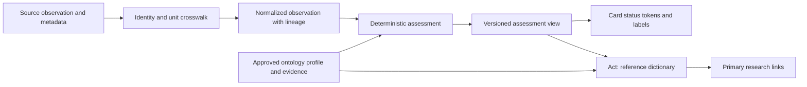

# Proposal: ontology-driven measurement attention and reference dictionary

Date: 2026-10-22 (America/Chicago). Status: **implementation planning authorized by Nate; proxy product-owner decisions recorded in section 11; runtime unimplemented**.
Origin: Nate's request for measurement-driven card color, explainable thresholds, US-first units and self-service research.
Planning work: UC-21 / DOC-7, W-93, W-96–W-108 and Ask C7/C8 in the [platform WSJF backlog](../backlog.md).
This proposal is the canonical design discussion; scoring lives only in the backlog. Nate subsequently delegated product-owner/SME planning and requested the full build/test/merge queue; section 11 governs that planning. Production threshold activation, physical commissioning and deployment remain separate evidence gates.

## 1. Product outcome and scope

A person sees an air-quality reading, immediately recognizes whether it needs attention, selects **Act → Understand this measurement**, sees exactly how the label was determined, then follows primary sources to investigate independently. A good reading should be reassuring; an unfavorable reading should be conspicuous and explainable. “Great” is permitted only where an approved profile defines it; do not invent a superior health category inside an authority's “Good” range.

Implementation pilot (amended): identified kitchen RH and dehumidifier reporting truth; named AQI and temperature conversion fixtures only. Live AQI enrollment remains held. The 2026-10-22 amendment below inventories the identified Git-recorded monitoring purposes and assigns researched or explicitly unresolved range profiles before that implementation pilot. Additional sensors and jurisdictions require evidence and adapter review. AQI is an index, not ppm or a universal air-quality unit. CO2, CO, VOC, particulate concentration and a manufacturer's composite air score are distinct concepts. An indoor instantaneous sensor value must not silently acquire an outdoor daily AQI interpretation.

The UI's measurement status comes entirely from an approved, versioned assessment contract. Themes own accessible colors; ontology policy owns semantic meaning. Device connectivity, alert state and measurement attention remain independently visible. Recommendations generated in-app, external search integration and device action execution are later product work.

## 2. Current baseline and reuse

Original inspection: GitHub main tree `e68dea60e37de2723eb7fcac35e0ad338d7a2896`. Amendment inventory baseline: commit `1f4a28374f9299ed99c00fbed8b8716c688eeb62`; architecture merged as [PR #241](https://github.com/ImpressiveLLC/FaceoftheCabin/pull/241), commit `d8d5c7597071259f23eb6b4c6107f1944ec61d60`. Source inspection is not live verification.

| Existing home | Evidence and proposed treatment |
|---|---|
| [ontology.yaml](../../ontology.yaml) | Semantic contract with canonical IDs, audience rendering, relation cardinality, transformation and four `normal_range` blocks. Temperature already stores °C and displays °F by default. Battery and humidity already describe warn/critical behavior. Existing prose ranges do not provide a uniform source/version/applicability contract. Preserve them pending explicit reconciliation; do not automatically convert them into approved policies. |
| [D7/D13/D15/D16/D27](../decisions/ontology-decisions.md) | Reuse service identity, measurement type, reporting topic and subject relations. Topic membership grants neither a threshold nor control capability. D16's computed reporting topic remains unchanged. |
| [DeviceReportingRelationship](../../../cabin-orchestration-platform/backend/src/main/java/com/cabin/orchestrator/devices/model/DeviceReportingRelationship.java) | Existing service identity is deviceId + semanticField; measurementType and curated displayLabel exist. Bind profiles to this identity through canonical measurement definitions, not device-name matching. |
| [OntologyLookupService](../../../cabin-orchestration-platform/backend/src/main/java/com/cabin/orchestrator/ontology/OntologyLookupService.java) | Currently returns ID, display name, entity type and found status, with a humanized fallback. Extend through a reviewed additive contract; this is not an assessment engine or complete dictionary today. Missing ontology cannot imply a successful assessment. |
| [DeviceDisplayConfig](../../../cabin-orchestration-platform/backend/src/main/java/com/cabin/orchestrator/devices/display/DeviceDisplayConfig.java) | Existing severityOverride can force OK/WARN/ALERT. Future measurement attention must not be overwritten by this profile setting. Audit callers and define compatibility before changing behavior; no override is removed in this PR. |
| [AlertSeverityClassifier](../../../cabin-orchestration-platform/backend/src/main/java/com/cabin/orchestrator/events/AlertSeverityClassifier.java) | Existing event classifier is separate. Measurement attention does not suppress, replace or create safety alerts automatically. |
| [UX Journey Standard](../../UX_JOURNEY_STANDARD.md) | Reuse See → Think → Act → Recover, theme tokens, structural/status color separation, keyboard/focus and return-context requirements. |

## 3. Architecture and ownership

Keep raw observations immutable. A backend assessment function selects exactly one applicable approved profile, validates comparability and freshness, normalizes into that profile's comparison unit, and produces an explanation with versioned lineage. Reuse telemetry and ontology loading; do not introduce a second ingestion or alert engine. UI formatting can change units without changing the assessment.

Proposed implementation shape: small typed policy records sourced from Git, validated at load/build time, an assessment service, an additive assessment response, and shared UI presentation rules usable by React and the static Family Hub. Use the existing API/security patterns after caller inventory; endpoint paths and storage migrations are intentionally undecided. Pin policy version per response; atomically load the dictionary and evaluator from the same approved bundle. Invalid bundles retain the prior valid version with visible version/freshness metadata, or return unavailable if none exists.

The ontology defines meaning and links; schema defines structure; evaluator defines execution; theme defines accessible presentation. No browser-side threshold copies, model-selected severity, or hard-coded component ranges.

## 4. Proposed ontology classes and fields

Names below are candidate vocabulary, not allocated production ontology IDs. Add linked classes/records rather than expanding every element into a sparse wide table. The dictionary may flatten these into columns for inspection. Reconcile names against the complete vocabulary before ratification.

| Proposed class | Required fields / constraints |
|---|---|
| MeasurementDefinition | Stable ID, ontology element reference, quantity kind, analyte/species, definition, scalar/categorical/vector shape, datatype, direction (higher-worse/lower-worse/two-sided/categorical), valid domain, context requirements, primary US display and secondary SI/international display, dictionary reference. |
| UnitDefinition | Stable unit code, symbol, dimension, quantity kind, basis (mass/volume/mole fraction/index), standard reference conditions if applicable. Unitless index carries named scheme/version. “ppm” alone is insufficient when basis is ambiguous. |
| ReportingCrosswalk | Source system/model/firmware + semantic field, target measurement ID, source unit/basis, source method and averaging window, mapping status (exact/conditional/lossy/unmappable), transform ID/version, required metadata, precision and uncertainty policy. No fuzzy field-name equivalence. |
| ThresholdProfile | ID/version, measurement ID, jurisdiction, indoor/outdoor/use context, population applicability, purpose (health guidance/comfort/device operation/empirical anomaly), comparison unit, method/window, minimum coverage, freshness limit, effective dates, evidence references, approval state/owner/reviewer and review-due date. |
| ThresholdBand | Profile ID, ordinal, bounds and inclusive flags or categorical set, native category, attention level, optional score, semantic status token, explanation; all supported values must resolve deterministically, with explicit out-of-domain handling. |
| EvidenceRecord | Publisher/title/URL/section, source revision/publication and retrieval dates, scope, claim supported, quoted extract location or approved snapshot/hash where permitted, provenance kind, derivation ID, uncertainty/limitations, curator, review state and supersession link. |
| DerivationRecord | Method/formula/code revision, input evidence and dataset versions/hashes, filters, units, context, sampling period, sample size, missingness, exclusions, statistics and validation report. Corpus chunks link to their authoritative source; retrieval rank is not evidence authority. |
| ObservationAssessment | Observation/service/measurement IDs, observedAt/receivedAt/evaluatedAt, raw value/unit, normalized value/unit, method/window, quality flags, profile/version, band, attention, optional score, conversion lineage, reason code, dictionary/version and source references. |

### Cardinality and identity

- One device has many reporting services; one service has many observations over time. Each scalar observation resolves to exactly one measurement definition. Split vector or multi-analyte payloads into traceable components before assessment.
- One measurement has many context-specific profiles and many source crosswalks. Each crosswalk targets one measurement definition; multiple sources can map to that definition without merging their observations.
- One profile has one or more bands and one or more evidence records. Evidence may support many profiles (N:M). A profile/version plus band ordinal is unique.
- One observation can have several explicitly requested assessments for different purposes/populations; each assessment selects exactly one profile/version. Its displayed primary purpose must be explicit. Equally specific conflicting profiles produce unknown/ambiguous, not “first row wins.”
- One definition has one dictionary entry with many localized renderings. Entries link to many sources and crosswalks. A card with many measurements references each assessment; never average unlike units or severity values.
- Location, room, device and service IDs remain stable; policy updates create new versions. Replays retain the original assessment or explicitly label recalculation under a newer profile.

### Deterministic attention contract

`attention = low | medium | high | unknown`. Low means little attention needed, not a low measurement value. Keep `native_category` and `quality_state` separate. A continuous universal “criticality score” would imply unsupported comparability across hazards. First release uses ordinal scores **0/1/2** for low/medium/high only if a consumer needs numeric sorting; unknown has null score and its own visible queue. These numbers are not probabilities, exposure estimates or comparable risk magnitudes. Richer within-profile scoring requires a reviewed formula and calibration.

Selection order: required measurement/scheme → compatible jurisdiction/context/purpose/population → method/window/unit basis → approved effective version → declared specificity. Missing required metadata, expired evidence review, incompatible mapping, stale/invalid observation or conflicting applicable profiles yields unknown with reason. Review expiry must be explicit policy, not an undocumented date heuristic.

Evaluate before display rounding. Every boundary has explicit inclusion and precision rules. Support lower-is-worse, higher-is-worse, two-sided and categorical bands. Missing, NaN, impossible values, missing units and out-of-domain results never default to low. “Unknown” does not erase a last-known high result: show its time and “last known high; current unavailable.” Hysteresis may stabilize presentation only if a versioned profile defines clear/recovery behavior; show current band and held attention separately and never delay initial high attention.

## 5. Units, federation and mastering

US-first is a presentation preference, not a universal change to scientific storage units or jurisdiction. Show °F first and °C second for US temperature; preserve °C source and canonical comparison values. For AQI show the named index and source scheme, not a fabricated US customary unit. International display uses SI where applicable and a named jurisdiction-specific index where relevant; there is no single international AQI.

- Absolute temperature: °F = °C × 9/5 + 32; intervals use the scale factor only. Example: 20 °C → 68 °F. A unit preference must leave band/attention invariant. [NIST temperature reference](https://www.nist.gov/pml/owm/si-units-temperature).
- For the same gas and explicitly matched volume basis, ppmv × 1000 = ppbv. Preserve wet/dry basis and reference conditions. Gas volume fraction to mass concentration requires species/molecular mass, temperature, pressure and an approved method; absent inputs mean incomparable. PM mass concentration cannot be converted to gaseous ppm by a generic multiplier. [NSW EPA measurement toolkit, sections 1.3–1.4](https://www.epa.nsw.gov.au/sites/default/files/240164localgovernmentairqualitytoolkitmodule1scienceairqualitypart3measurairquality.pdf).
- AQI conversion is a named pollutant/method/window-specific derivation using the adopted breakpoint revision and preprocessing rules. A daily average, an instantaneous concentration and a NowCast are not interchangeable. Different national indexes require separate schemes; do not use a linear index-to-index crosswalk.
- Keep original field, value, unit, timestamp, device method and provider alongside the canonical observation. Deduplicate only with verified event identity; retain source-specific uncertainty and conflicting readings. Never average two sensors solely because they map to the same measurement.
- Master definitions and source aliases through reviewed crosswalks. Record exact/conditional/lossy/unmappable status in the dictionary. Unknown units are a curation gap, not an invitation to guess.

## 6. Research and reference-range governance

Evidence precedence for the same applicable purpose: relevant current primary authority/standard → validated device-method documentation → peer-reviewed evidence → approved empirical derivation → explicitly labeled local preference. Scope outranks prestige: outdoor public-health guidance is not automatically indoor sensor guidance; occupational limits are not household comfort targets. Preserve competing guidance with context rather than blending it into a universal average.

Research procedure: inventory actual source metadata and existing ranges; identify the precise quantity and decision purpose; collect primary sources with versions and applicability; reconcile disagreements; encode boundaries/window/method; validate conversion and examples; domain review plus Nate's ratification; publish a versioned bundle and dictionary together. Review on source revision, changed sensor method, new jurisdiction, dataset drift or review-due date.

Datasets/corpus may support an empirical baseline only when provenance, coverage, missingness, sampling bias and validation are recorded. Percentiles can define “unusual for this room,” not “safe” or “healthy.” Research-derived and dataset-derived thresholds remain proposals until reviewed; an LLM may locate or summarize evidence but never self-approve an operational range.

### Researched pilot evidence (accessed 2026-10-22)

| Source | Supported use | Limits / next evidence needed |
|---|---|---|
| [AirNow AQI basics](https://www.airnow.gov/aqi/aqi-basics/) | Six official concern categories and index ranges; retain them in dictionary and badge. | Public AQI interpretation, not proof of indoor sensor equivalence. |
| [EPA AQS breakpoint table](https://aqs.epa.gov/aqsweb/documents/codetables/aqi_breakpoints.html) (page dated October 21, 2026) | Pollutant and duration-specific breakpoints; PM2.5 24-hour Good concentration range 0.0–9.0, Moderate 9.1–35.4. | Units/method/preprocessing must be confirmed in the adopted technical method before concentration-to-AQI implementation. Table alone is insufficient. Do not import its database sentinels as unlimited healthy/valid values. |
| [AirNow using AQI](https://www.airnow.gov/aqi/aqi-basics/using-air-quality-index/) | Current AirNow air quality uses NowCast; temporal semantics must accompany the reading. | Actual chosen provider's reporting method and metadata remain to be inventoried. |
| [NIST temperature reference](https://www.nist.gov/pml/owm/si-units-temperature) | Exact temperature scale conversion. | Does not establish comfort or freeze thresholds. |
| [NSW EPA measurement toolkit](https://www.epa.nsw.gov.au/sites/default/files/240164localgovernmentairqualitytoolkitmodule1scienceairqualitypart3measurairquality.pdf), July 2024, sections 1.3–1.4 | Distinguishes mass/volume concentration and required gas conversion conditions. | Does not authorize a particular sensor crosswalk or household threshold. |

Illustrative US AQI attention profile for **integer, valid provider-reported US AQI**:

| AQI | Native category | Proposed attention | Proposed status token |
|---|---|---|---|
| 0–50 | Good | low | positive |
| 51–100 | Moderate | medium | caution |
| 101–150 | Unhealthy for Sensitive Groups | high | danger |
| 151–200 | Unhealthy | high | danger |
| 201–300 | Very Unhealthy | high | danger |
| 301–500 | Hazardous | high | danger |

The category boundaries come from AirNow; the three attention levels and tokens are **our proposed UX mapping**, not EPA classifications. Preserve all six native categories and an official category legend even when card emphasis collapses them. Above 500: high/out-of-scale with explanation, never clamp to Good; invalid negatives: unknown. Fractional AQI needs a provider-defined preprocessing rule; do not silently round. Sensitive-population profiles may be more conservative and must be separately reviewed. No approved “Great” sub-band is asserted.

## 7. Ontology ↔ UX contract

**See:** show measurement name, value with US-first/secondary units where meaningful, native category, attention text/icon and observation age. Apply approved status token to a card accent/background through existing theme tokens. Structural colors remain structural. Low can be calm positive; medium conspicuous caution; high danger with explicit label; unknown neutral patterned/outlined with “Unavailable / cannot compare.” Color never carries meaning alone. Preserve existing critical-alert presentation independently.

A multi-measurement card uses maximum known attention plus a visible unknown-count badge; if all are unknown, card is unknown. Show the determining measurement(s); never let good AQI obscure a high CO reading. This aggregation is visual only and grants no command or alert suppression. A native AQI badge retains its category label; official category colors, if shown, need accessible rendering and a legend separate from generic card attention.

**Think:** selecting the status reveals “Why this status?” with the actual value, matching range, purpose/context, method/window, source, version and freshness/uncertainty. “No approved range” and “unit cannot be compared” are actionable explanations. Existing severity overrides cannot make an unfavorable measurement appear favorable.

**Act:** a measurement's menu includes **Understand this measurement** and opens its exact dictionary definition in context. This informational action performs no device command. Dictionary supports search/browse by human name, alias, analyte, unit and reporting scheme. Show plain-language definition first, range table with current match, original versus normalized value, conversion/crosswalk with conditional/lossy warnings, source metadata, evidence/derivation methods and direct primary research links. Advanced lineage expands on demand.

**Recover:** close/back restores location, card, tab, scroll and keyboard focus. Broken sources retain recorded citation metadata and show unavailability. Missing profiles lead to a visible evidence gap; avoid an empty pane. Respect existing permission filtering and demo redaction. External research uses public measurement/scheme/method terms; household topology, precise location and raw telemetry are excluded by default.

Future option: user-initiated search seeded with measurement + index scheme + reporting metadata, with a preview of what leaves the app. In-app recommendations need separate evidence, evaluation, privacy and action-authority design in the Ask backlog; no recommendation quality or execution is implied here.

## 8. Decomposition, gates and iteration

The [backlog](../backlog.md) owns proposed scores. Dependencies override numerical WSJF order.

| Slice | Deliverable and exit evidence |
|---|---|
| DOC-7 | Research/decision workshop: approve attention semantics, profile applicability, source hierarchy and pilot feed. Reconcile existing normal_range entries and overrides. Outcome is ratified policy direction or named unresolved questions. |
| W-96 | Typed schema and versioned pilot bundle. Validate identity/cardinality, references, units/basis, effective versions, explicit boundaries and coverage, source provenance and approval state. Candidate classes reconciled into ontology/schema/context as appropriate by reviewed migration. No change to every element at once. |
| W-97 | Backend normalization/assessment and additive response. Golden fixtures for unit invariance, boundaries, stale/missing/ambiguous/incompatible inputs and source lineage; no command or alert changes. Contract/caller compatibility verified. |
| W-98 | Measurement card states and Act dictionary journey using the same profile version. Automated behavior/accessibility checks plus visual review across themes, phone/kiosk/desktop and a human comprehension session. |
| W-99 | Additional measurement and international-context pilot. Select from actual inventory; verify source metadata and approved evidence first. Include dataset derivation only where justified; prove non-equivalence remains visible. |
| W-100 | Operational rollout gates: policy bundle version/health diagnostics, replay and rollback, change-review process, drift monitoring; approved dictionary indexing belongs to C7/C2. Existing alerts preserved; live validation remains separate. |

Iteration 0: DOC-7 and mockup review. Iteration 1: W-96 then W-97, read-only fixtures/shadow comparison. Iteration 2: W-98 with RH/reporting live scope and named AQI/conversion fixtures. Iteration 3: W-99; W-100 before production rollout. Re-score after each discovery; split any implementation slice whose feasibility exceeds its provisional size. No dates or staffing commitments are implied.

### Acceptance scenarios

1. Valid same-scheme AQI 25: Good / low; AQI 175: Unhealthy / high; Act opens the exact profile/version and source-backed explanation for each.
2. Native six-category distinctions survive the three-level attention summary. No unsupported “Great” health claim.
3. Boundary pairs 50/51, 100/101, 150/151, 200/201 and 300/301 resolve once each; fractional, negative and >500 inputs follow explicit rules.
4. 20 °C and 68 °F produce the same attention under the same temperature profile. Absolute and interval conversions differ correctly; display rounding cannot change classification.
5. ppmv/ppbv convert only for matched analyte/basis; missing temperature/pressure/species for mass conversion yields incomparable. A proprietary score labeled “air quality” never becomes US AQI by alias alone.
6. Instant PM2.5 never uses a 24-hour threshold without required aggregation/coverage. Conflicting or incomplete profiles remain unknown with reason.
7. Missing/stale/invalid observations cannot look Good. Last-known high remains dated and visible; an unrelated good measurement cannot hide it.
8. Card accent, labels, icons, screen-reader output and dictionary agree across themes. Act/back preserves focus and context; no device action is invoked.
9. Each assessment reproduces from observation + profile + transform versions. A policy rollback restores the earlier version atomically; old evaluations remain traceable.
10. Approved pilot definitions/ranges/crosswalks have complete source coverage. Derived ranges include reproducible dataset evidence; missing checks remain NOT_RUN.

Proposed release evidence: 100% deterministic golden fixtures pass; zero incompatible-unit “healthy” results; every rendered state has a non-color explanation; every assessed pilot range links to approved evidence. Human comprehension target and pilot sample size must be agreed during DOC-7 rather than fabricated here.

## 9. Decisions requested and present limits

The original questions are dispositioned by Nate’s proxy product owner in section 11. Cowork owns independent semantic/evidence review, Code owns feasibility/implementation, and Nate retains final authority and physical commissioning. Do not continue treating answered product choices as unanswered user questions. Evidence gaps remain explicit tasks, not invented facts.

This PR establishes proposal and prioritization bones only. Live feed availability, sensor accuracy, corpus completeness, implemented schema/API, usability and production behavior are **NOT_RUN / unverified**. Existing thresholds and safety behavior are unchanged. Do not mark this proposal's implementation work complete when the documentation merges.

## 10. Device-purpose range inventory — amendment 2026-10-22

This amendment is the only new repository artifact: it extends this framework, not a second catalog or a production ontology migration. Every range below is **proposed**, every runtime activation flag is **false**, and every live enrollment/reporting check is **NOT_RUN**. Merging the document records the design and research; it does not install a threshold engine or authorize notifications, actuation or suppression of existing safety alerts.

### 10.1 Taxonomy and inventory authority

There is no single Git file containing every device ever recognized. Authority is split by fact:

| Fact | Source of truth | Finding |
|---|---|---|
| Semantic meaning, canonical vocabulary, human rendering | [ontology.yaml](../../ontology.yaml), ratified [D-decisions](../decisions/ontology-decisions.md) | Contains types and historical concrete instances; not a full live registry export. |
| Executable device taxonomy | [DeviceType.java](../../../cabin-orchestration-platform/backend/src/main/java/com/cabin/orchestrator/devices/model/DeviceType.java), DeviceCategory and capabilities | Runtime classification; conceptual ontology types do not automatically become executable enum values. |
| Per-service measurement vocabulary | [D7MeasurementTypes.java](../../../cabin-orchestration-platform/backend/src/main/java/com/cabin/orchestrator/devices/model/D7MeasurementTypes.java) and [reporting schema](../../ontology/schema/device-reporting-relationship.schema.json) | Closed 14-value vocabulary; PM1/2.5/4/10, VOC/NOx index and illuminance are not all covered. A reviewed extension must preserve schema/code parity. |
| Ordered/planned hardware, purpose and room | [Doc 27 allocation manifest](../../hardware/doc27-device-inventory.json) and [engineering plan](../../hardware/doc27-environmental-nodes.md) | Manifest says explicitly it is not a complete export of existing hub devices. 39 device allocations, many not assembled or commissioned; no runtime IDs manufactured here. |
| Actual discovered/configured identity and lifecycle | [DeviceRegistry](../../../cabin-orchestration-platform/backend/src/main/java/com/cabin/orchestrator/devices/DeviceRegistry.java), persisted `device` rows via JdbcDeviceLifecycleStore | Current runtime authority; 14 code seeds are disabled, not evidence of installed devices. Passive undecided discovery is not a durable all-time ledger. |
| Actual fields reported by a device | DeviceReportingRelationship / JdbcDeviceReportingRelationshipRepository (`device_reporting_relationship`) and source observations | Bind `(location, deviceId, semanticField)` to quantity, method, unit and purpose. Fields seen in a model spec are expected channels, not proof of telemetry. |
| Device-history clues | [MAINTENANCE.md](../../MAINTENANCE.md), discovery records and Git history | Useful recognition evidence; no new taxonomy authority. Includes attic sensor and existing dehumidifier outlet not reconciled into the planned allocation list. |

The 75 records below comprise 39 allocation records, 13 concrete ontology Zigbee records, 7 additional ontology appliance/camera/network records, 14 disabled seeds and 2 historical maintenance recognitions. This is **record coverage, not 75 unique physical devices**. Different records may represent the same device. Alias reconciliation and a permission-filtered runtime export remain required before claiming all-current or all-ever-seen coverage.

Future all-ever-recognized coverage requires an append-only recognition/tombstone history with first/last seen, source, lifecycle and alias-to-canonical mappings. Preserve records after retirement; do not create a parallel editable device registry from this document. Git does not establish current liveness.

### 10.2 Recommended vocabulary: Normal / Watch / Alert, plus independent reporting status

Use **Normal** (within this purpose-specific band), **Watch** (review trend/context), **Alert** (prompt attention). These replace acceptable/questionable/unacceptable: they describe attention without claiming universal safety. They map to section 4 low/medium/high and scores 0/1/2 respectively. `Unclassified` means no applicable valid assessment; `Not applicable` covers settings/metadata/non-monitoring parts. Neither is Normal.

Reporting health is a separate axis; `unknown` is used only when the cause cannot be established:

| Reporting state | Evidence needed / user wording | Next step |
|---|---|---|
| Reporting | Fresh valid measurement under that service’s declared cadence/window. Device heartbeat alone is insufficient. | Normal/Watch/Alert assessment may be shown. |
| Late / missed | Expected interval / grace exceeded, with last actual observation time. | Check reporting path; do not assert physical device failure from elapsed time alone. |
| Device offline | Fresh explicit device-scoped protocol availability assertion; include source, timestamp, expiry and exact claim. Failed probes are a separate no-response fact (section 14). | Inspect power/network/device. A failed probe proves no response to that probe, not why. |
| Service unavailable | Fresh HA/API/collector/bridge failure with dependency scope. | Restore that service; physical device state may remain unknown. |
| Measurement unsupported | Verified converter/model or schema cannot provide that channel. | Correct adapter/version/capability mapping; do not call the whole device offline. |
| Never reported | Configured service has no actual observation. | Verify enrollment/channel/unit mapping. |
| Not configured | Disabled, deferred, planned or uncommissioned. | Setup or commission if intended; do not create a failure alert. |
| Unknown | No fresh evidence supports a more specific reason. | Show known facts and evidence gap. |

Required reporting metadata: `state`, `reason_code`, `evidence_source`, `scope`, `observed_at`, `expires_at`, `affected_service_ids`, `last_valid_observation_id`, expected interval and reporting mode. Event-driven quiet is not failed telemetry; resting alarm state needs its declared heartbeat/parent-health contract. An explicit expired offline record becomes “last known offline; current status unknown.” Preserve dated last-known Alert while current measurement is unavailable.

[Current DeviceHealthMonitor](../../../cabin-orchestration-platform/backend/src/main/java/com/cabin/orchestrator/devices/DeviceHealthMonitor.java) already has ON_SCHEDULE/LATE/MISSED/NOT_CONFIGURED. It also sets OFFLINE after missed timeouts and exempts CO_SENSOR silence by forcing ON_SCHEDULE. Reuse its evidence and cadence, but neither shortcut proves physical reachability. A future adapter must preserve explicit failure scope and not reinterpret these status strings as new evidence.

Card rendering: known Alert measurement remains red with its date; reporting failure adds a separately labeled connectivity/service badge. No current measurement means unavailable styling and a reporting reason, never a green card. With no Alert, use Watch for a known adverse measurement and retain the reporting badge. A card composed entirely of unavailable measurements uses neutral unavailable styling. Color, label, icon and accessible description must agree. Informational Act opens dictionary/recovery; it never executes a device command.

### 10.3 Interoperable metadata shape and cardinality

Use one structured `measurement_range_binding_ref` per device/allocation rather than separate sparse normal/watch/alert columns. It resolves to many service-specific assignments; each assignment references one measurement definition and one profile/version **per purpose**. One service may have multiple named purposes; do not merge them into one unqualified threshold. Definition → profile → bands/evidence/transformations stays normalized. The UI dictionary can flatten these into columns.

Proposed binding fields: `record_ref`, `runtime_device_id` (nullable until reconciled), `location`, `parent_record_ref`, `purpose`, `service_ref/semanticField`, `measurement_ref`, `profile_ref/version`, `assignment_state`, `reporting_contract_ref`, `crosswalk_ref`, `source_ref`, `evidence_status`. Profile fields include unit/analyte/index scheme, lower/upper bound and inclusion, category, attention, temporal aggregation/coverage/persistence, applicability, provenance, derivation, approval/version/effective dates and review trigger.

Proposed ontology classes are MeasurementAttentionProfile, MeasurementPurposeBinding and ObservationReportingStatus. They remain candidates inside this proposal; no ontology IDs, schema or manifest fields are added by this amendment. An eventual implementation places canonical definitions in ontology, normalized policy records in a validated versioned data source, and the reference on each manifest/runtime service. The source of truth must not be duplicated across browser thresholds and backend policy.

FAIR alignment: stable IDs and dictionary indexing (Findable); canonical Git/API retrieval with authorization and retained metadata (Accessible); typed shared quantity/unit/scheme and qualified relations (Interoperable); provenance, version, applicability and license metadata (Reusable). “t” is treated here as additional **traceability** from source through transformation to observation/card, not a claim that a formal FAIRt certification exists. [GO FAIR principles](https://www.gofair.foundation/fair-principles).

### 10.4 Evidence and source register

Accessed 2026-10-22. Repository source content is pinned to the inventory baseline above. External sources retain publisher rights; store citation/version/hash or permitted snapshot at implementation. Recheck changing pages before activation. Publisher statements and local UX mappings are different kinds of evidence.

| Ref | Source / section | Supported fact | Limits |
|---|---|---|---|
| epa-rh | [EPA: Biological contaminants and indoor air quality](https://www.epa.gov/indoor-air-quality-iaq/biological-contaminants-and-indoor-air-quality) — Moisture control | Indoor RH below 60%; ideal 30–50%. | Not outdoor RH; a transient excursion does not prove mold. |
| mdh-co2 | [Minnesota Department of Health: Carbon dioxide](https://www.health.state.mn.us/communities/environment/air/toxins/co2.html) — Why do we measure CO2? | Indoor CO2 is a ventilation screening proxy; guidance discusses below 1000 ppm. | Not an acute toxicity threshold or proof that other pollutants are absent. |
| hse-co2 | [HSE: Using CO2 monitors](https://www.hse.gov.uk/ventilation/using-co2-monitors.htm) — Understanding the numbers and when to take action | Consistently above 1500 ppm in occupied rooms indicates poor ventilation. | Workplace guidance adapted as a proposed household screening policy; persistence requires commissioning. |
| hc-co2 | [Health Canada: residential CO2 guideline](https://www.canada.ca/en/health-canada/services/publications/healthy-living/residential-indoor-air-quality-guidelines-carbon-dioxide.html) — 7.1; published 2021-03-19 | 1000 ppm long-term guideline, 24-hour average. | Separate Canadian profile; cannot label a single reading a 24-hour exposure. |
| epa-pm | [EPA: 2024 PM AQI update](https://www.epa.gov/system/files/documents/2024-02/pm-naaqs-air-quality-index-fact-sheet.pdf) — Pages 1–3; effective 2024-05-06 | PM2.5 breakpoints and native US AQI categories. | Ambient-air scheme; indoor adaptation is explicitly proposed and not regulatory compliance. |
| aqs | [EPA AQS AQI breakpoint reference](https://aqs.epa.gov/aqsweb/documents/codetables/aqi_breakpoints.html) — Parameters 88101, 81102; 24-hour rows; page dated 2026-10-22 | PM2.5/PM10 concentration breakpoints depend on duration and reference conditions. | Live table can change; review adopted revision and preprocessing before implementation. |
| sen6x | [Sensirion SEN6x datasheet](https://sensirion.com/resource/datasheet/SEN6x) — Version 1.0 October 2026, product overview and sections 1.2–1.7 | SEN66 reports PM, RH, temperature, VOC/NOx indices and CO2. | Capability and engineering domain are not an appropriateness/health range. |
| voc-index | [Sensirion VOC Index information note](https://sensirion.com/media/documents/02232963/6294E043/Info_Note_VOC_Index.pdf) — Page 1 | Index 1–500, relative baseline 100; example action above 150. | Not concentration, species identification or health safety; illustrative action threshold. |
| nox-index | [Sensirion NOx Index information note](https://sensirion.com/media/documents/9F289B95/6294DFFC/Info_Note_NOx_Index.pdf) — Page 1 | Index 1–500, baseline 1; example action above 20. | Relative index, not NO2 concentration or health limit. |
| kidde | [Kidde KN-COP-DP-10YL-AQ-WF user guide](https://brand.kidde.com/m/53a25a3fe6a04243/original/UG_KN-COP-DP-10YL-AQ-WF.pdf) — P/N 2565-7201-03 Rev.A; sections 1, 10, 14 | Device CO alarm behavior and proprietary indoor-air-quality categories. | Manufacturer category is not US AQI; manual does not establish a directly measured CO2 channel. Map integration fields before classification. |
| usda | [USDA FSIS: Refrigeration and food safety](https://www.fsis.usda.gov/food-safety/safe-food-handling-and-preparation/food-safety-basics/refrigeration) — Safe refrigerator temperature | Refrigerator at or below 40°F. | Air-temperature excursion is not a determination of food condition or discard time. Primary publisher search excerpts verified; full-page fetch returned 403 during this review. Re-open the full source at policy approval. |
| usda-freezer | [USDA FSIS: Freezing and food safety](https://www.fsis.usda.gov/food-safety/safe-food-handling-and-preparation/food-safety-basics/freezing-and-food-safety) — Freezer / refrigerator temperatures | Freezer at or below 0°F for long-term storage. | Storage guidance; not a universal acute food-safety threshold. Primary publisher search excerpts verified; full-page fetch returned 403 during this review. Re-open the full source at policy approval. |
| redcross | [American Red Cross: Frozen pipes](https://www.redcross.org/get-help/how-to-prepare-for-emergencies/types-of-emergencies/winter-storm/frozen-pipes.html) — How to prevent frozen pipes | When away in cold weather, thermostat no lower than 55°F. | Thermostat advice does not prove a specific pipe temperature or validate a remote ambient threshold. |
| nist | [NIST SI units: Temperature](https://www.nist.gov/pml/owm/si-units-temperature) — Temperature conversion | Absolute °F = °C × 9/5 + 32; intervals have no offset. | Conversion only; no appropriateness limits. |
| local-ontology | [FaceoftheCabin ontology](../../ontology.yaml) — temperature_celsius; humidity_percent; battery_percent; link_quality | Existing local envelopes and known-device semantics. | Local operational policy and historical documentation, not independent clinical or engineering validation. |
| doc27 | [Doc 27 environmental-node plan](../../hardware/doc27-environmental-nodes.md) — Services, circulation, commissioning | Sensor channels, purposes, distinct sources; mixing thresholds deliberately require commissioning. | Ordered/planned equipment; actual exposures and enrollment unverified. |
| maintenance | [Maintenance history](../../MAINTENANCE.md) — Adding a Zigbee smart plug or switch that measures power (2026-10-21) | Attic T/RH sensor and dehumidifier outlet recognized; unsupported converter can publish null energy channels. | Historical observation; no current live status asserted. |
| fair | [GO FAIR principles](https://www.gofair.foundation/fair-principles) — F1–F4, A1/A2, I1–I3, R1 | Persistent identity, discoverable interoperable metadata, provenance and reuse. | This package is FAIR-aligned; no certification is claimed. |

### 10.5 Proposed range profiles

Notation: `[a,b]` includes both bounds; `(a,b)` excludes them; infinities are unbounded. Assess only after source identity/unit/basis/window validation and finite numeric checks. Device measurement domains and accuracy remain separate from appropriateness bands. All numeric policies below need purpose/method commissioning and reviewer ratification before runtime activation; `normal` means only the named criterion. Unresolved profiles have **no band**, intentionally—not a green default.

| Profile ID / metric / comparison unit | Normal / Watch / Alert bands | Source refs | Derivation / applicability / temporal contract |
|---|---|---|---|
| `indoor-rh` / humidity / % | normal: [30, 50] (Preferred moisture range); watch: [0, 30) (Dry); (50, 60) (Elevated moisture); alert: [60, 100] (High moisture; investigate) | epa-rh | EPA ideal and upper-moisture guidance mapped to local attention; 50–60 watch, below 30 dry watch. Alert is review attention, not mold detection. Context: indoor_ambient, not_outdoor_not_duct_process. Window: latest_valid_observation. |
| `ambient-local` / temperature / Cel | normal: [15.5, 26.6] (Local preferred band); watch: [3.3, 15.5) (Cool); (26.6, 35] (Warm); alert: (-∞, 3.3) (Local freeze precaution); (35, ∞) (Hot; review context) | local-ontology | Preserve exact source Celsius cutoffs 3.3/15.5/26.6/35; resolve legacy overlap with explicit boundaries. Not a health or device-rating standard. Context: occupied_indoor_ambient. Window: latest_valid_observation. |
| `freeze-precaution` / temperature / Cel | normal: [12.77777778, ∞) (Above proposed lower precaution; not a pipe guarantee); watch: [3.3, 12.77777778) (Below proposed cold-weather precaution); alert: (-∞, 3.3) (Local freeze precaution) | local-ontology, redcross | Existing <3.3°C high-attention trigger retained exactly (37.94°F, historically rounded to 38°F). Proposed early-watch boundary 55°F = 115/9°C adapts thermostat advice; not proven pipe protection. Context: indoor_ambient_near_plumbing, upper_heat_envelope_separately_assessed. Window: latest_valid_observation. |
| `outdoor-freeze-context` / temperature / Cel | normal: (0, ∞) (Above freezing exterior context); watch: (-∞, 0] (Freezing exterior context); alert: none | local-ontology, nist | 0°C reference used as weather context only. Exterior cold does not establish an interior pipe alarm. Context: outdoor, no_indoor_comfort_or_pipe_state_inference. Window: latest_valid_observation. |
| `co2-ventilation` / co2 / ppm{CO2} | normal: [0, 1000) (Below screening threshold); watch: [1000, 1500] (Review ventilation trend); alert: (1500, ∞) (High ventilation concern when persistent) | mdh-co2, hse-co2 | US/local 1000 ppm guidance and HSE consistently >1500 ppm combined into proposed screening bands. Persistence is a commissioning input, not a health exposure rule. Context: occupied_room, direct_CO2_sensor, stabilized_valid_signal. Window: latest_valid_observation. |
| `co2-ca-24h` / co2 / ppm{CO2} | normal: [0, 800) (normal); watch: [800, 1000] (watch); alert: (1000, ∞) (alert) | hc-co2 | 1000 ppm 24-hour reference retained separately; local watch onset 800 ppm is an explicit proposed early-warning margin, not a Health Canada category. Context: canadian_residential_reference, direct_CO2_sensor. Window: 24h_mean. Coverage: must_be_validated_before_activation. |
| `sensirion-voc` / voc_index / 1{Sensirion_VOC_Index} | normal: [1, 100] (At/below learned background); watch: (100, 150] (Above learned background); alert: (150, 500] (Large relative VOC event) | voc-index, sen6x | Baseline 100 and manufacturer example action above 150 become proposed normal/watch/alert. Not a TVOC concentration or health judgment. Context: Sensirion_VOC_scheme, learning_and_warmup_complete. Window: latest_valid_observation. |
| `sensirion-nox` / nox_index / 1{Sensirion_NOx_Index} | normal: = 1 (Learned background); watch: (1, 20] (Above learned background); alert: (20, 500] (Relative NOx event) | nox-index, sen6x | Baseline 1 and manufacturer example action above 20 mapped to attention; no concentration or health equivalence. Context: Sensirion_NOx_scheme, learning_and_warmup_complete. Window: latest_valid_observation. |
| `pm25-24h-screen` / pm2_5 / ug/m3 | normal: [0, 9] (normal); watch: (9, 35.4] (watch); alert: (35.4, ∞) (alert) | epa-pm, aqs | 24-hour mean explicitly truncated to 0.1 µg/m³ before matching 0–9.0, 9.1–35.4, >=35.5. Indoor adaptation is proposed. Not an instantaneous AQI conversion or NAAQS compliance decision. Context: 24h_PM2.5_mean, source_conditions_validated. Window: 24h_mean. Preprocess: truncate_to_0.1_before_band_match. Coverage: commissioning_required; no missing-as-zero. |
| `pm10-24h-screen` / pm10 / ug/m3 | normal: [0, 54] (normal); watch: (54, 154] (watch); alert: (154, ∞) (alert) | aqs | 24-hour mean explicitly truncated to whole µg/m³ before matching 0–54, 55–154, >=155. Source PM10 uses STP; incompatible reference conditions block classification. Context: 24h_PM10_mean, STP_basis_confirmed. Window: 24h_mean. Preprocess: truncate_to_integer_before_band_match. Coverage: commissioning_required; no missing-as-zero. |
| `us-aqi` / air_quality_index / 1{US_EPA_AQI} | normal: [0, 50] (Good); watch: (50, 100] (Moderate); alert: (100, 150] (Unhealthy for Sensitive Groups); (150, 200] (Unhealthy); (200, 300] (Very Unhealthy); (300, 500] (Hazardous); (500, ∞) (Beyond AQI scale) | epa-pm | Native six categories retained; local attention grouping Good=normal, Moderate=watch, all worse=alert. >500 remains alert/out-of-scale. Context: verified_US_EPA_AQI_scheme, provider_method_known, integer_index. Window: latest_valid_observation. |
| `battery-local` / battery / % | normal: [20, 100] (normal); watch: [10, 20) (watch); alert: [0, 10) (alert) | local-ontology | Existing local <10 alert, 10–<20 watch, >=20 normal retained; not a chemistry-independent remaining-runtime guarantee. Context: verify_device_purpose. Window: latest_valid_observation. |
| `lqi-local` / linkquality / 1{LQI} | normal: [150, 255] (normal); watch: [100, 150) (watch); alert: [0, 100) (alert) | local-ontology | Existing local <100 poor, 100–<150 fair, >=150 good mapped to alert/watch/normal; poor LQI is not device offline. Context: verify_device_purpose. Window: latest_valid_observation. |
| `leak` / water_leak / 1{state} | normal: false (No leak reported); watch: none; alert: true (Leak detected) | local-ontology | Existing binary leak semantics retained; no middle band required. Context: actual_leak_sensor, fresh_or_latched_valid_state. Window: latest_valid_observation. |
| `door` / contact / 1{state} | normal: true (Closed); watch: false (Open); alert: none | local-ontology | Native contact true=closed, false=open. Open=watch follows existing classifier; armed intrusion escalation remains separate. Context: verify_device_purpose. Window: latest_valid_observation. |
| `motion` / occupancy / 1{state} | normal: false (No motion reported); true (Motion reported); watch: none; alert: none | local-ontology | Both states informational without armed/authorization context; no fabricated hazard. Context: verify_device_purpose. Window: latest_valid_observation. |
| `safety-alarm` / alarm / 1{state} | normal: false (No alarm reported); watch: none; alert: true (Alarm reported) | kidde, local-ontology | Asserted alarm always alert. Clear means no alarm asserted, never a certification of safe air. Context: verify_device_purpose. Window: latest_valid_observation. |
| `low-battery` / battery_low / 1{state} | normal: false (Not asserted); watch: true (Battery low); alert: none | local-ontology | Native boolean mapped to watch; preserve any stronger manufacturer alarm independently. Context: verify_device_purpose. Window: latest_valid_observation. |
| `tamper` / tamper / 1{state} | normal: false (Not asserted); watch: true (Tamper reported); alert: none | local-ontology | Native boolean mapped to watch; preserve any stronger manufacturer alarm independently. Context: verify_device_purpose. Window: latest_valid_observation. |
| `bucket-full` / bucket_full / 1{state} | normal: false (Not asserted); watch: true (Bucket full); alert: none | doc27 | Native boolean mapped to watch; preserve any stronger manufacturer alarm independently. Context: verify_device_purpose. Window: latest_valid_observation. |
| `device-fault` / fault / 1{state} | normal: false (No fault reported); watch: none; alert: true (Fault reported) | doc27 | Only actual manufacturer fault flag, not arbitrary nonzero data. Context: verify_device_purpose. Window: latest_valid_observation. |
| `fridge` / temperature / [degF] | normal: [32, 38] (normal); watch: (-∞, 32) (Potential food freezing); (38, 40] (watch); alert: (40, ∞) (Above refrigerated-storage guidance) | usda | USDA upper bound 40°F; proposed early-watch at 38°F, lower watch below 32°F for unwanted freezing. These margins are local product choices. Context: verified_refrigerator_compartment, actual_temperature_not_setpoint. Window: latest_valid_observation. |
| `freezer` / temperature / [degF] | normal: (-∞, 0] (normal); watch: (0, 10] (watch); alert: (10, ∞) (Local freezer warming escalation) | usda-freezer | USDA target <=0°F; warmer is watch, not immediate food danger. Proposed local high attention >10°F requires review; never an automatic discard instruction. Context: verified_freezer_compartment, actual_temperature_not_setpoint. Window: latest_valid_observation. |
| `pm1-unresolved` / pm1 / ug/m3 | Unclassified / informational; no range adopted | sen6x | Unresolved or informational; intentionally no numeric bands. Context: verify_device_purpose. Window: latest_valid_observation. No generally applicable PM1 household appropriateness standard established; do not borrow PM2.5 bands. |
| `pm4-unresolved` / pm4 / ug/m3 | Unclassified / informational; no range adopted | sen6x | Unresolved or informational; intentionally no numeric bands. Context: verify_device_purpose. Window: latest_valid_observation. No generally applicable PM4 household appropriateness standard established; do not borrow PM2.5 bands. |
| `co-trend-unresolved` / co / ppm{CO} | Unclassified / informational; no range adopted | kidde | Unresolved or informational; intentionally no numeric bands. Context: verify_device_purpose. Window: latest_valid_observation. Do not substitute ambient 1h/8h limits for a certified CO alarm. Verify reporting method, range and cadence; no green safety inference. |
| `tvoc-unresolved` / tvoc / source_declared | Unclassified / informational; no range adopted | kidde, voc-index | Unresolved or informational; intentionally no numeric bands. Context: verify_device_purpose. Window: latest_valid_observation. Kidde and Sensirion outputs are not interchangeable. Verify vendor category/crosswalk and mixture-calibration basis; no universal TVOC health threshold. |
| `vendor-iaq-unresolved` / air_quality_index / source_declared_index | Unclassified / informational; no range adopted | kidde | Unresolved or informational; intentionally no numeric bands. Context: verify_device_purpose. Window: latest_valid_observation. Vendor category/index scheme and boundary mapping require verification; never treat a proprietary index as EPA AQI. |
| `eco2-unresolved` / eco2 / ppm{eCO2} | Unclassified / informational; no range adopted | kidde | Unresolved or informational; intentionally no numeric bands. Context: verify_device_purpose. Window: latest_valid_observation. Equivalent CO2 is not measured CO2; field provenance and algorithm required. |
| `pressure-unresolved` / pressure / source_declared | Unclassified / informational; no range adopted | local-ontology | Unresolved or informational; intentionally no numeric bands. Context: verify_device_purpose. Window: latest_valid_observation. Distinguish air pressure from water pressure and obtain purpose, rated equipment range and reference basis. |
| `delta-uncommissioned` / delta_temperature / Cel | Unclassified / informational; no range adopted | doc27 | Unresolved or informational; intentionally no numeric bands. Context: verify_device_purpose. Window: latest_valid_observation. Doc 27 explicitly leaves mixing start/stop, persistence, skew and minimum cycles to commissioning. No universal healthy delta. |
| `temperature-context-unresolved` / temperature / Cel | Unclassified / informational; no range adopted | doc27 | Unresolved or informational; intentionally no numeric bands. Context: verify_device_purpose. Window: latest_valid_observation. Attic, duct, garage, or equipment temperature requires design/material/pipe context; no occupied-room comfort assumption. |
| `rh-context-unresolved` / humidity / % | Unclassified / informational; no range adopted | epa-rh, doc27 | Unresolved or informational; intentionally no numeric bands. Context: verify_device_purpose. Window: latest_valid_observation. Outdoor/attic/duct RH requires condensation/material/surface-temperature context; do not label exterior RH >=60% an indoor mold alarm. |
| `power-unresolved` / power / W | Unclassified / informational; no range adopted | doc27 | Unresolved or informational; intentionally no numeric bands. Context: verify_device_purpose. Window: latest_valid_observation. Obtain actual load rating, mode and commissioned baseline; zero power may be correct. |
| `current-unresolved` / current / A | Unclassified / informational; no range adopted | doc27 | Unresolved or informational; intentionally no numeric bands. Context: verify_device_purpose. Window: latest_valid_observation. Obtain circuit, motor/continuous-load rating and installation; no generic 15/16A safety band. |
| `voltage-unresolved` / voltage / V | Unclassified / informational; no range adopted | doc27 | Unresolved or informational; intentionally no numeric bands. Context: verify_device_purpose. Window: latest_valid_observation. Supply/battery voltage require model, chemistry and applicable design range. |
| `energy-informational` / energy / kW.h | Unclassified / informational; no range adopted | doc27 | Unresolved or informational; intentionally no numeric bands. Context: verify_device_purpose. Window: latest_valid_observation. Cumulative kWh has no universal high-is-bad band; compare period/budget only under reviewed policy. |
| `light-informational` / illuminance / lx | Unclassified / informational; no range adopted | local-ontology | Unresolved or informational; intentionally no numeric bands. Context: verify_device_purpose. Window: latest_valid_observation. Motion sensor light context is not a commissioned task-lighting target. |
| `switch-context` / switch_state / 1{state} | Unclassified / informational; no range adopted | doc27 | Unresolved or informational; intentionally no numeric bands. Context: verify_device_purpose. Window: latest_valid_observation. On/off appropriateness depends on expected operation; never infer physical flow or heater output from command state. |
| `lock-context` / lock_state / 1{state} | Unclassified / informational; no range adopted | local-ontology | Unresolved or informational; intentionally no numeric bands. Context: verify_device_purpose. Window: latest_valid_observation. Locked/unlocked appropriateness depends on user intent and authorized context. |
| `speed-context` / speed_level / 1{level} | Unclassified / informational; no range adopted | doc27 | Unresolved or informational; intentionally no numeric bands. Context: verify_device_purpose. Window: latest_valid_observation. Commanded level is not measured RPM or airflow; commissioning target required. |
| `airflow-unmeasured` / airflow / source_declared | Unclassified / informational; no range adopted | doc27 | Unresolved or informational; intentionally no numeric bands. Context: verify_device_purpose. Window: latest_valid_observation. No roof-draft/airflow sensor or commissioned design target found. Temperature and relay power do not establish airflow adequacy. |
| `uptime-informational` / uptime / s | Unclassified / informational; no range adopted | doc27 | Unresolved or informational; intentionally no numeric bands. Context: verify_device_purpose. Window: latest_valid_observation. Uptime alone is not a measurement of service health. |
| `firmware-informational` / firmware / 1{version} | Unclassified / informational; no range adopted | doc27 | Unresolved or informational; intentionally no numeric bands. Context: verify_device_purpose. Window: latest_valid_observation. Version inventory; no scalar appropriateness range. |
| `wifi-unresolved` / wifi_signal / source_declared | Unclassified / informational; no range adopted | kidde | Unresolved or informational; intentionally no numeric bands. Context: verify_device_purpose. Window: latest_valid_observation. Source may use dBm, RSSI or percent; require units and adapter meaning. |
| `replacement-unresolved` / weeks_to_replace / wk | Unclassified / informational; no range adopted | kidde | Unresolved or informational; intentionally no numeric bands. Context: verify_device_purpose. Window: latest_valid_observation. Use actual manufacturer service-life warning and verified date, not invented week bands. |
| `operating-informational` / operating_state / 1{state} | Unclassified / informational; no range adopted | doc27 | Unresolved or informational; intentionally no numeric bands. Context: verify_device_purpose. Window: latest_valid_observation. Native appliance operation requires mode-specific vocabulary. |
| `setpoint-not-observation` / setpoint / 1{state} | Unclassified / informational; no range adopted | doc27 | Unresolved or informational; intentionally no numeric bands. Context: verify_device_purpose. Window: latest_valid_observation. A target setting is not an observation and cannot make the measured card healthy. |

Additional interpretation rules:

- Indoor RH above 60% is a moisture concern, not a mold detector. Bathroom shower excursions still show the current band; notification persistence remains unselected. Do not reuse this profile for exterior/attic/duct process RH.
- The 55°F freeze-watch margin adapts thermostat guidance to ambient screening. It is a local proposal, not proof that a remote pipe is protected; existing <3.3°C precaution is retained exactly. Heat-related attention is separately assessed; a lower-bound freeze profile cannot declare all high temperatures appropriate.
- CO2 profile is ventilation screening. Direct CO2, eCO2 and CO are separate quantities. The Canadian 24-hour reference stays separate from current occupied-room screening. No “safe air” claim from a Normal proxy.
- PM2.5/PM10 profiles require valid 24-hour aggregation and compatible reference conditions; current instantaneous sensor values remain unclassified for those profiles until a valid aggregate exists. They are explicitly proposed indoor adaptations of ambient references. No instantaneous-to-daily substitution or missing-as-zero.
- Sensirion VOC/NOx indices are relative manufacturer scales after warmup/learning. Their Alert cutoffs are example-event mappings, not health limits. No generic ppm or mass conversion. PM1/PM4 have explicit unresolved dispositions rather than borrowed PM2.5 bands.
- Fridge Watch margins and freezer >10°F escalation are proposed local choices. Compartment-air temperature and food temperature/time exposure differ. Never generate a discard instruction solely from these bands.
- Electrical load/supply limits require actual nameplate/circuit/mode/commissioned baseline. Energy accumulation, device on/off and fan speed do not have universal good/bad ranges. Physical airflow is not inferred from fan power or a command level.

### 10.6 Device/allocation assignments

Notation `source field → profile` preserves service cardinality. Profiles with no adopted range stay Unclassified. Every row below is documented/planned/historical unless explicitly stated as a disabled seed; **none is newly live-verified**. Battery-low and other diagnostics apply only if actually exposed. An assembly rollup does not create a second telemetry source. The proposed column is `measurement_range_binding_ref`; the record key below is the target design reference.

| Binding / source record | Purpose / identity status | Source field → profile |
|---|---|---|
| `allocation-monitor-main` — Sensor Collection Box — Cabin / Main Level / Air Quality; monitor-main | air_quality; **planning_not_live** | No numeric monitoring channel documented; assembly_rollup |
| `allocation-monitor-main-sen66` — Environmental Sensor — Cabin / Main Level / Air Quality; monitor-main-sen66 | air_quality; **planning_not_live** | `temperature` → `ambient-local`; `humidity` → `indoor-rh`; `pm1` → `pm1-unresolved`; `pm2_5` → `pm25-24h-screen`; `pm4` → `pm4-unresolved`; `pm10` → `pm10-24h-screen`; `co2` → `co2-ventilation`; `voc_index` → `sensirion-voc`; `nox_index` → `sensirion-nox` |
| `allocation-monitor-main-sht45` — Ambient Temperature Humidity Sensor — Cabin / Main Level / Air Quality; monitor-main-sht45 | air_quality; **planning_not_live** | `temperature` → `ambient-local`; `humidity` → `indoor-rh` |
| `allocation-monitor-main-mcu` — Sensor Node Controller — Cabin / Main Level / Air Quality; monitor-main-mcu | air_quality; **planning_not_live** | `uptime` → `uptime-informational`; `firmware` → `firmware-informational`; `wifi_signal` → `wifi-unresolved` |
| `allocation-monitor-main-adapter` — Sensor Interface Adapter — Cabin / Main Level / Air Quality; monitor-main-adapter | air_quality; **planning_not_live** | No numeric monitoring channel documented; no_monitoring_channel_documented |
| `allocation-control-bath` — Relay Control Box — Cabin / Bathroom / Exhaust And Heat; control-bath | exhaust_and_heat; **planning_not_live** | No numeric monitoring channel documented; assembly_rollup |
| `allocation-control-bath-sen66` — Environmental Sensor — Cabin / Bathroom / Exhaust And Heat; control-bath-sen66 | exhaust_and_heat; **planning_not_live** | `temperature` → `ambient-local`; `humidity` → `indoor-rh`; `pm1` → `pm1-unresolved`; `pm2_5` → `pm25-24h-screen`; `pm4` → `pm4-unresolved`; `pm10` → `pm10-24h-screen`; `co2` → `co2-ventilation`; `voc_index` → `sensirion-voc`; `nox_index` → `sensirion-nox` |
| `allocation-control-bath-sht45` — Ambient Temperature Humidity Sensor — Cabin / Bathroom / Exhaust And Heat; control-bath-sht45 | exhaust_and_heat; **planning_not_live** | `temperature` → `ambient-local`; `humidity` → `indoor-rh` |
| `allocation-control-bath-mcu` — Sensor Node Controller — Cabin / Bathroom / Exhaust And Heat; control-bath-mcu | exhaust_and_heat; **planning_not_live** | `uptime` → `uptime-informational`; `firmware` → `firmware-informational`; `wifi_signal` → `wifi-unresolved` |
| `allocation-control-bath-adapter` — Sensor Interface Adapter — Cabin / Bathroom / Exhaust And Heat; control-bath-adapter | exhaust_and_heat; **planning_not_live** | No numeric monitoring channel documented; no_monitoring_channel_documented |
| `allocation-control-mech` — Relay Control Box — Cabin / Mechanical Room / Climate Control; control-mech | climate_control; **planning_not_live** | No numeric monitoring channel documented; assembly_rollup |
| `allocation-control-mech-sen66` — Environmental Sensor — Cabin / Mechanical Room / Climate Control; control-mech-sen66 | climate_control; **planning_not_live** | `temperature` → `ambient-local`; `humidity` → `indoor-rh`; `pm1` → `pm1-unresolved`; `pm2_5` → `pm25-24h-screen`; `pm4` → `pm4-unresolved`; `pm10` → `pm10-24h-screen`; `co2` → `co2-ventilation`; `voc_index` → `sensirion-voc`; `nox_index` → `sensirion-nox`; `temperature` → `freeze-precaution` |
| `allocation-control-mech-sht45` — Ambient Temperature Humidity Sensor — Cabin / Mechanical Room / Climate Control; control-mech-sht45 | climate_control; **planning_not_live** | `temperature` → `ambient-local`; `humidity` → `indoor-rh`; `temperature` → `freeze-precaution` |
| `allocation-control-mech-mcu` — Sensor Node Controller — Cabin / Mechanical Room / Climate Control; control-mech-mcu | climate_control; **planning_not_live** | `uptime` → `uptime-informational`; `firmware` → `firmware-informational`; `wifi_signal` → `wifi-unresolved` |
| `allocation-control-mech-adapter` — Sensor Interface Adapter — Cabin / Mechanical Room / Climate Control; control-mech-adapter | climate_control; **planning_not_live** | No numeric monitoring channel documented; no_monitoring_channel_documented |
| `allocation-monitor-lower-deferred` — Sensor Collection Box — Cabin / Lower Level / Air Quality; monitor-lower-deferred | air_quality; **planning_not_live** | No numeric monitoring channel documented; assembly_rollup |
| `allocation-relay-1` — Metered Relay — Cabin / Bathroom / Exhaust; relay-1 | exhaust; **planning_not_live** | `power` → `power-unresolved`; `current` → `current-unresolved`; `voltage` → `voltage-unresolved`; `energy` → `energy-informational`; `state` → `switch-context` |
| `allocation-relay-2` — Metered Relay — Cabin / Bathroom / Heat; relay-2 | heat; **planning_not_live** | `power` → `power-unresolved`; `current` → `current-unresolved`; `voltage` → `voltage-unresolved`; `energy` → `energy-informational`; `state` → `switch-context` |
| `allocation-relay-3` — Metered Relay — Cabin / Mechanical room / Air circulation; relay-3 | air_circulation; **planning_not_live** | `power` → `power-unresolved`; `current` → `current-unresolved`; `voltage` → `voltage-unresolved`; `energy` → `energy-informational`; `state` → `switch-context` |
| `allocation-relay-4` — Metered Relay — Cabin / Mechanical room / Reserved channel B; relay-4 | reserved_channel_b; **planning_not_live** | `power` → `power-unresolved`; `current` → `current-unresolved`; `voltage` → `voltage-unresolved`; `energy` → `energy-informational`; `state` → `switch-context` |
| `allocation-control-bath-supply` — Node Power Supply — Cabin / Bathroom / Sensor Power; control-bath-supply | sensor_power; **planning_not_live** | No numeric monitoring channel documented; no_monitoring_channel_documented |
| `allocation-control-mech-supply` — Node Power Supply — Cabin / Mechanical Room / Sensor Power; control-mech-supply | sensor_power; **planning_not_live** | No numeric monitoring channel documented; no_monitoring_channel_documented |
| `allocation-toggle-exhaust` — Local Control Switch — Cabin / Bathroom / Exhaust; toggle-exhaust | exhaust; **planning_not_live** | No numeric monitoring channel documented; no_monitoring_channel_documented |
| `allocation-toggle-heat` — Local Control Switch — Cabin / Bathroom / Heat; toggle-heat | heat; **planning_not_live** | No numeric monitoring channel documented; no_monitoring_channel_documented |
| `allocation-outlet-circulation` — Controlled Outlet — Cabin / Pending Location / Circulation Alternative; outlet-circulation | circulation_alternative; **planning_not_live** | `power` → `power-unresolved`; `current` → `current-unresolved`; `voltage` → `voltage-unresolved`; `energy` → `energy-informational`; `state` → `switch-context` |
| `allocation-outlet-unassigned` — Controlled Outlet — Cabin / Pending Location / Unassigned; outlet-unassigned | unassigned; **planning_not_live** | `power` → `power-unresolved`; `current` → `current-unresolved`; `voltage` → `voltage-unresolved`; `energy` → `energy-informational`; `state` → `switch-context` |
| `allocation-home-th-mechanical_room` — Temperature Humidity Sensor — Home / Mechanical Room / Equipment Monitoring; home-th-mechanical_room | equipment_monitoring; **planning_not_live** | `temperature` → `freeze-precaution`; `humidity` → `indoor-rh`; `battery` → `battery-local`; `linkquality` → `lqi-local`; `battery_low` → `low-battery` |
| `allocation-home-th-laundry_room` — Temperature Humidity Sensor — Home / Laundry Room / Equipment Monitoring; home-th-laundry_room | equipment_monitoring; **planning_not_live** | `temperature` → `freeze-precaution`; `humidity` → `indoor-rh`; `battery` → `battery-local`; `linkquality` → `lqi-local`; `battery_low` → `low-battery` |
| `allocation-home-th-dishwasher_sink_area` — Temperature Humidity Sensor — Home / Dishwasher Sink Area / Equipment Monitoring; home-th-dishwasher_sink_area | equipment_monitoring; **planning_not_live** | `temperature` → `freeze-precaution`; `humidity` → `indoor-rh`; `battery` → `battery-local`; `linkquality` → `lqi-local`; `battery_low` → `low-battery` |
| `allocation-home-th-garage` — Temperature Humidity Sensor — Home / Garage / Ambient Monitoring; home-th-garage | ambient_monitoring; **planning_not_live** | `temperature` → `temperature-context-unresolved`; `humidity` → `rh-context-unresolved`; `battery` → `battery-local`; `linkquality` → `lqi-local`; `battery_low` → `low-battery` |
| `allocation-home-th-basement_storage` — Temperature Humidity Sensor — Home / Basement Storage / Ambient Monitoring; home-th-basement_storage | ambient_monitoring; **planning_not_live** | `temperature` → `temperature-context-unresolved`; `humidity` → `indoor-rh`; `battery` → `battery-local`; `linkquality` → `lqi-local`; `battery_low` → `low-battery` |
| `allocation-cabin-th-lower-duct` — Temperature Humidity Sensor — Cabin / Basement central duct / Lower temperature reference; cabin-th-lower-duct | lower_temperature_reference; **planning_not_live** | `temperature` → `temperature-context-unresolved`; `humidity` → `rh-context-unresolved`; `battery` → `battery-local`; `linkquality` → `lqi-local`; `battery_low` → `low-battery` |
| `allocation-dehumidifier` — Connected Dehumidifier — Cabin / Pending Location / Humidity Control; dehumidifier | humidity_control; **planning_not_live** | `humidity` → `indoor-rh`; `setpoint` → `setpoint-not-observation`; `operating_state` → `operating-informational`; `bucket_full` → `bucket-full`; `fault` → `device-fault` |
| `allocation-circulator` — Inline Air Circulator — Cabin / Pending Location / Inter Level Air Mixing; circulator | inter_level_air_mixing; **planning_not_live** | `speed_level` → `speed-context`; `delta_temperature` → `delta-uncommissioned`; `airflow` → `airflow-unmeasured` |
| `allocation-bathroom-exhaust-load` — Exhaust Fan — Cabin / Bathroom / Exhaust; bathroom-exhaust-load | exhaust; **planning_not_live** | No numeric monitoring channel documented; no_monitoring_channel_documented |
| `allocation-bathroom-heat-load` — Space Heater — Cabin / Bathroom / Heat; bathroom-heat-load | heat; **planning_not_live** | No numeric monitoring channel documented; no_monitoring_channel_documented |
| `allocation-circulator-manual-controller` — Manual Fan Speed Controller — Cabin / Pending Location / Inter Level Air Mixing; circulator-manual-controller | inter_level_air_mixing; **planning_not_live** | No numeric monitoring channel documented; no_monitoring_channel_documented |
| `allocation-circulator-speed-node` — None; circulator-speed-node | inter_level_air_mixing_speed; **planning_not_live** | No numeric monitoring channel documented; no_monitoring_channel_documented |
| `allocation-circulator-speed-isolator` — None; circulator-speed-isolator | inter_level_air_mixing_speed; **planning_not_live** | No numeric monitoring channel documented; no_monitoring_channel_documented |
| `ontology-zigbee_leak_alarm_bathroom` — Bathroom Leak Alarm; zigbee_leak_alarm_bathroom | Physical water-leak/siren sensor mounted in the bathroom, one of 13 paired Zigbee devices on the cabin mesh. Reports water_leak (boolean), battery (0-100), battery_low (boolean), and linkquality (0-255) on every Z2M state message. Distin...; **documented_historical** | `water_leak` → `leak`; `battery` → `battery-local`; `linkquality` → `lqi-local`; `battery_low` → `low-battery` |
| `ontology-zigbee_motion_entry` — Entry Motion Sensor; zigbee_motion_entry | PIR motion + ambient-light sensor covering the cabin's entry area. Reports occupancy (boolean), illuminance (lux), battery, and linkquality. Unlike the leak sensors, occupancy is NOT one of AlertSeverityClassifier's CRITICAL/WARN conditi...; **documented_historical** | `occupancy` → `motion`; `illuminance` → `light-informational`; `battery` → `battery-local`; `linkquality` → `lqi-local`; `battery_low` → `low-battery` |
| `ontology-zigbee_door_front_contact` — Front Door Contact; zigbee_door_front_contact | Reed-switch contact sensor on the front door. Reports contact (boolean, false = open), tamper, battery, voltage, and linkquality. contact: false is one of AlertSeverityClassifier's WARN conditions (see event_severity) — a door open event...; **documented_historical** | `contact` → `door`; `tamper` → `tamper`; `battery` → `battery-local`; `linkquality` → `lqi-local`; `battery_low` → `low-battery`; `voltage` → `voltage-unresolved` |
| `ontology-zigbee_door_second_contact` — Second Door Contact; zigbee_door_second_contact | Reed-switch contact sensor on the cabin's second door (not further specified which door in current documentation — worth clarifying with the user in a future pass, not assumed here). Same attribute set and event_severity WARN behavior as...; **documented_historical** | `contact` → `door`; `tamper` → `tamper`; `battery` → `battery-local`; `linkquality` → `lqi-local`; `battery_low` → `low-battery`; `voltage` → `voltage-unresolved` |
| `ontology-zigbee_temp_outside_lowest` — Outside Low Temperature Probe; zigbee_temp_outside_lowest | Outdoor temperature/humidity probe, positioned (per its friendly_name) to read the coldest exterior point being tracked — relevant to freeze-risk monitoring for the cabin's plumbing (see CabinAutomations' leak_freeze_automations.yaml, a ...; **documented_historical** | `temperature` → `outdoor-freeze-context`; `humidity` → `rh-context-unresolved`; `battery` → `battery-local`; `linkquality` → `lqi-local`; `battery_low` → `low-battery` |
| `ontology-zigbee_temp_kitchen` — Kitchen Temperature/Humidity; zigbee_temp_kitchen | Kitchen temperature/humidity sensor. Reports temperature, humidity, battery, linkquality — pure telemetry, not currently wired into any alerting logic.; **documented_historical** | `temperature` → `ambient-local`; `humidity` → `indoor-rh`; `battery` → `battery-local`; `linkquality` → `lqi-local`; `battery_low` → `low-battery` |
| `ontology-zigbee_leak_mech_room` — Mechanical Room Leak Sensor; zigbee_leak_mech_room | Water-leak sensor in the mechanical room (water heater/pump/valve area) — arguably the highest-consequence leak location on the mesh given what else is in that room. Reports water_leak, battery, battery_low, linkquality. No built-in sire...; **documented_historical** | `water_leak` → `leak`; `battery` → `battery-local`; `linkquality` → `lqi-local`; `battery_low` → `low-battery` |
| `ontology-zigbee_leak_alarm_fridge` — Fridge Leak Alarm; zigbee_leak_alarm_fridge | Water-leak sensor positioned at the kitchen fridge (note: distinct from the Liebherr fridge's own smart_appliance_fridge_liebherr integration entity — this is an independent physical leak sensor, not part of the fridge's own SmartDevice ...; **documented_historical** | `water_leak` → `leak`; `battery` → `battery-local`; `linkquality` → `lqi-local`; `battery_low` → `low-battery` |
| `ontology-zigbee_temp_mech_room` — Mechanical Room Temperature/Humidity; zigbee_temp_mech_room | Mechanical room temperature/humidity sensor — relevant to freeze-risk monitoring (same caveat as zigbee_temp_outside_lowest: the actual freeze-risk automation logic lives in the separate CabinAutomations repo, not tracked by code in this...; **documented_historical** | `temperature` → `freeze-precaution`; `humidity` → `indoor-rh`; `battery` → `battery-local`; `linkquality` → `lqi-local`; `battery_low` → `low-battery` |
| `ontology-zigbee_heater_mech_room` — Mechanical Room Heater Plug; zigbee_heater_mech_room | Smart plug controlling the mechanical room's freeze-prevention heater. Unlike the sensor-only devices above, this is a COMMAND-capable actuator (on/off, and this model's power/energy monitoring), not just telemetry — reports state (on/of...; **documented_historical** | `power` → `power-unresolved`; `current` → `current-unresolved`; `voltage` → `voltage-unresolved`; `energy` → `energy-informational`; `state` → `switch-context`; `linkquality` → `lqi-local` |
| `ontology-zigbee_main_water_valve` — Main Water Valve; zigbee_main_water_valve | COMMAND-capable relay actuating the cabin's main water shutoff valve — the highest-consequence actuator on this mesh, since triggering it (correctly or incorrectly) cuts water to the entire property. Reports state (on/off = valve open/cl...; **documented_historical** | `state` → `switch-context`; `linkquality` → `lqi-local` |
| `ontology-zigbee_leak_alarm_dishwasher` — Dishwasher Leak Alarm; zigbee_leak_alarm_dishwasher | Water-leak sensor positioned at the kitchen dishwasher (note: distinct from smart_appliance_dishwasher_bosch, which is a not-yet-built Home Connect cloud integration for the dishwasher itself — this is an independent physical leak sensor...; **documented_historical** | `water_leak` → `leak`; `battery` → `battery-local`; `linkquality` → `lqi-local`; `battery_low` → `low-battery` |
| `ontology-zigbee_smart_switch_breaker_box` — Breaker Box Smart Switch; zigbee_smart_switch_breaker_box | Smart plug at the breaker box — COMMAND-capable (on/off) with power/energy monitoring (power, energy, current, voltage, linkquality), same capability set as zigbee_heater_mech_room but a different controlled load and location. Exact cont...; **documented_historical** | `power` → `power-unresolved`; `current` → `current-unresolved`; `voltage` → `voltage-unresolved`; `energy` → `energy-informational`; `state` → `switch-context`; `linkquality` → `lqi-local` |
| `ontology-kidde` — Living Room Kidde CO/Temp/Humidity (Cabin Upstairs); smart_appliance_co_air_quality_kidde | CO safety alarm plus vendor indoor-air-quality and maintenance channels; **documented_historical** | `temperature` → `ambient-local`; `humidity` → `indoor-rh`; `co` → `co-trend-unresolved`; `co2` → conditional/unresolved: direct measured CO2 evidence required; persistent profile held; `eco2` → `eco2-unresolved`; `tvoc` → `tvoc-unresolved`; `air_quality_index` → `vendor-iaq-unresolved`; `pressure` → `pressure-unresolved`; `alarm` → `safety-alarm`; `battery` → `battery-local`; `battery_low` → `low-battery`; `wifi_signal` → `wifi-unresolved`; `weeks_to_replace` → `replacement-unresolved` |
| `ontology-liebherr` — Loonie Mc Frigerton (Liebherr Combi Fridge); smart_appliance_fridge_liebherr | Separate actual refrigerator and freezer compartment temperatures from setpoints; **documented_historical** | `sensor.loonie_mc_frigerton_top_zone` → `fridge`; `sensor.loonie_mc_frigerton_bottom_zone` → `freezer`; `top_zone_setpoint` → `setpoint-not-observation`; `bottom_zone_setpoint` → `setpoint-not-observation` |
| `ontology-smart_appliance_dishwasher_bosch` — Kitchen Dishwasher (Bosch); smart_appliance_dishwasher_bosch | The cabin's Bosch dishwasher, connectable via Bosch's Home Connect platform (shared across Bosch/Siemens/Neff/Balay appliances).; **documented_status_not_live_verified** | No numeric monitoring channel documented; reporting/stream/network diagnostics only |
| `ontology-hw_camera_reolink_rlc820a_01` — Reolink RLC-820A (unit 01); hw_camera_reolink_rlc820a_01 | The physical hardware unit — make, model, and native protocol capability only. Says nothing about where it's mounted, what it's used for, or whether it's currently reachable/configured; that's camera_role_front_door, which currently poin...; **documented_status_not_live_verified** | No numeric monitoring channel documented; reporting/stream/network diagnostics only |
| `ontology-hw_camera_blink_outdoor4_01` — Blink Outdoor 4 ('DHEE', unit 01); hw_camera_blink_outdoor4_01 | The physical hardware unit only. Says nothing about where it's mounted or how it's integrated into this platform; that's camera_role_driveway, which currently points at this entry.; **documented_status_not_live_verified** | No numeric monitoring channel documented; reporting/stream/network diagnostics only |
| `ontology-hw_router_c4000lg` — C4000LG Router; hw_router_c4000lg | The physical router hardware only — make, model, and network address as UPnP-discovered. Clarified by the user 2026-08-07: this unit has no assigned network role — it's kept as backup/spare hardware, potentially to be pressed into servic...; **documented_status_not_live_verified** | No numeric monitoring channel documented; reporting/stream/network diagnostics only |
| `ontology-hw_starlink_terminal` — Starlink Terminal; hw_starlink_terminal | The property's internet uplink hardware. Unlike the router-role question above, this device's role is unambiguous — there is one Starlink terminal and it does one job (internet uplink) — so no separate derived "role" entry was created; h...; **documented_status_not_live_verified** | No numeric monitoring channel documented; reporting/stream/network diagnostics only |
| `seed-home-cam-front` — Home Front Door Camera; home-cam-front | Disabled code seed; intended camera; **disabled_seed_not_installed** | No numeric monitoring channel documented; reporting/stream/network diagnostics only |
| `seed-home-cam-driveway` — Home Driveway Camera; home-cam-driveway | Disabled code seed; intended camera; **disabled_seed_not_installed** | No numeric monitoring channel documented; reporting/stream/network diagnostics only |
| `seed-home-cam-backyard` — Home Backyard Camera; home-cam-backyard | Disabled code seed; intended camera; **disabled_seed_not_installed** | No numeric monitoring channel documented; reporting/stream/network diagnostics only |
| `seed-home-cam-garage` — Home Garage Camera; home-cam-garage | Disabled code seed; intended camera; **disabled_seed_not_installed** | No numeric monitoring channel documented; reporting/stream/network diagnostics only |
| `seed-home-cam-side` — Home Side Door Camera; home-cam-side | Disabled code seed; intended camera; **disabled_seed_not_installed** | No numeric monitoring channel documented; reporting/stream/network diagnostics only |
| `seed-home-lock-front` — Home Front Door Lock; home-lock-front | Disabled code seed; intended lock; **disabled_seed_not_installed** | `lock_state` → `lock-context` |
| `seed-home-lock-back` — Home Back Door Lock; home-lock-back | Disabled code seed; intended lock; **disabled_seed_not_installed** | `lock_state` → `lock-context` |
| `seed-home-thermostat-main` — Home Thermostat; home-thermostat-main | Disabled code seed; intended thermostat; **disabled_seed_not_installed** | `temperature` → `ambient-local`; `setpoint` → `setpoint-not-observation` |
| `seed-home-smoke-co-main` — Home Smoke/CO Alarm; home-smoke-co-main | Disabled code seed; intended smoke alarm; **disabled_seed_not_installed** | `alarm` → `safety-alarm` |
| `seed-home-energy-main` — Home Energy Monitor; home-energy-main | Disabled code seed; intended power meter; **disabled_seed_not_installed** | `power` → `power-unresolved`; `current` → `current-unresolved`; `voltage` → `voltage-unresolved`; `energy` → `energy-informational` |
| `seed-home-lg-washer` — Home LG Washer; home-lg-washer | Disabled code seed; intended washing machine; **disabled_seed_not_installed** | `operating_state` → `operating-informational`; `fault` → `device-fault` |
| `seed-home-lg-dryer` — Home LG Dryer; home-lg-dryer | Disabled code seed; intended dryer; **disabled_seed_not_installed** | `operating_state` → `operating-informational`; `fault` → `device-fault` |
| `seed-home-bosch-dishwasher` — Home Bosch Dishwasher; home-bosch-dishwasher | Disabled code seed; intended dishwasher; **disabled_seed_not_installed** | `operating_state` → `operating-informational`; `fault` → `device-fault` |
| `seed-home-daikin-hvac` — Home Daikin Aurora HVAC; home-daikin-hvac | Disabled code seed; intended thermostat; **disabled_seed_not_installed** | `temperature` → `ambient-local`; `setpoint` → `setpoint-not-observation` |
| `recognized-attic-sensor` — Cabin attic SONOFF SNZB-02P; docs/MAINTENANCE.md#2026-10-21-zigbee-parent-service-and-unsupported-converter-findings | Attic temperature/RH; not occupied-room comfort; **historical_runtime_id_unresolved** | `temperature` → `temperature-context-unresolved`; `humidity` → `rh-context-unresolved`; `battery` → `battery-local`; `linkquality` → `lqi-local`; `battery_low` → `low-battery` |
| `recognized-dehumidifier-outlet` — Cabin existing dehumidifier S61 outlet; docs/governance/backlog.md#W-93 | Powering an existing dehumidifier; not proof that this is the ordered Midea; **historical_converter_unsupported** | `power` → `power-unresolved`; `current` → `current-unresolved`; `voltage` → `voltage-unresolved`; `energy` → `energy-informational`; `state` → `switch-context` |

Binding qualifications:

- SEN66 and SHT45 T/RH are distinct service identities. Prefer SHT45 for ambient reference only after enclosure-bias comparison; do not overwrite one with the other. SEN66 channels are expected from manufacturer specification; D7/UI end-to-end support is not established by this assignment.
- `monitor-main`, `control-bath` and `control-mech` aggregate child services only. `monitor-lower-deferred` is not ordered/enrolled and adds no lower-level air-quality coverage. Physical parts with no monitoring channels receive Not applicable, not fabricated readings.
- `cabin-th-lower-duct` temperature joins the upper SHT45 only for the separately commissioned signed temperature-difference profile. Retain both input IDs/times; require max age/skew and start > stop. No universal start/stop numbers were chosen in Doc 27, so none are invented here.
- Home equipment-location temperature assignments are conditional on verified ambient placement and plumbing purpose. Garage/duct/attic channels require context-specific commissioning; their outdoor/structural conditions do not inherit occupied-room comfort or indoor humidity alarms.
- Existing dehumidifier outlet and attic sensor are historical recognition rows. Their association with any ordered allocation is unresolved; reconcile runtime identity before treating them as additional units. The existing dehumidifier is explicitly distinct from the ordered Midea Cube. Converter-null metering is measurement unsupported, not proof the outlet is offline.
- CLOUDLINE S6 electrical readings belong to its metered supply relay, not a second direct sensor on the fan. Manual speed, future reported speed and actual airflow remain distinct. No roof draft/reflective-coating performance profile can be claimed without actual measurement and an installation-specific target.
- Kidde integration fields described as CO2 must be proven directly measured before using `co2-ventilation`; otherwise use `eco2-unresolved`. The model manual supports CO and proprietary IAQ but does not establish a direct CO2 channel. Preserve vendor-native IAQ categories pending exact crosswalk verification. Native CO alarm remains authoritative and separately visible.
- Liebherr top/bottom compartment mapping must be confirmed against actual device configuration before binding fridge/freezer policy; setpoints are not observations. Bosch integration and disabled Home seeds remain uncommissioned unless a fresh registry export proves otherwise.

### 10.7 Mastering and conversion rules

| Crosswalk | Method | Cardinality / required metadata |
|---|---|---|
| `identity` | preserve | one source observation to one canonical observation; analyte, unit, basis, method, window, source_identity; none_when_exactly_matched |
| `temperature-absolute` | F = C * 9/5 + 32; C = (F - 32) * 5/9 | 1:1; absolute_temperature, source_unit; display_rounding_only; classify_before_rounding |
| `temperature-delta` | delta_F = delta_C * 9/5; no offset | two distinct matched observations to one derived delta with both IDs retained; upper_service, lower_service, observed_at_each, max_age, max_skew, ambient_reference_verified; derived; no replacement of raw sources |
| `gas-fraction` | ppbv = ppmv * 1000 for same analyte and same gas basis; mass conversion blocked without molecular mass, pressure, temperature and reference conditions | 1:1 conditional; analyte, volume_or_mole_basis, wet_dry_basis, reference_conditions; no_conversion_when_incomplete |
| `source-verification` | Do not map by unit or field name alone; require source scheme/method confirmation | unresolved until source reviewed; raw_field, unit, analyte_or_index_scheme, device_model, firmware, integration_version; unmappable_until_verified |

Use exact unit-aware numerical values internally; US-first display is independent. °F precedes °C for US temperature users. Gas concentration retains recognized ppm/ppb basis; PM remains µg/m³; proprietary indices retain their named scheme. International presentation means SI where applicable and named local standards—not one invented international AQI. Pressure must identify gas versus plumbing context; voltage must distinguish supply from battery.

Raw observations remain immutable. A conversion is normally 1:1; multiple sensors remain multiple observations. Derived mixing delta is 2:1 with both source IDs, values and times retained. Temporal aggregation is N:1 with window/coverage/missingness/version. Profile/evidence links are N:M; each displayed assessment selects exactly one version per declared purpose. Conflicting equally applicable profiles produce Unclassified with reason. No source deduplication based on matching label/unit alone.

### 10.8 Implementation prerequisites and verification

[HomeAssistantDiscoveryService](../../../cabin-orchestration-platform/backend/src/main/java/com/cabin/orchestrator/integrations/homeassistant/HomeAssistantDiscoveryService.java) currently maps `volatile_organic_compounds` and `aqi` to AIR_QUALITY_SENSOR, whose numeric semantic field is `airQualityIndex`. Its unclassified `ppm` fallback infers CO_SENSOR. **Do not attach the same range to these normalized fields.** First retain raw device class, unit, analyte/index scheme, source entity and integration/model version; resolve exact/conditional/unmappable crosswalks. Add regression fixtures for measured CO2, eCO2, CO, VOC concentration, VOC Index and US/vendor AQI before activation. Preserve historical raw data and explicitly flag previously ambiguous normalized rows.

Historical #242 amendment allocated no IDs. Section 11 subsequently adds UC-21 and W-101–W-108; section 14 governs review corrections. This document now supplies W-96’s initial profile/binding research, but W-96 is not complete: schema, source review, live identity reconciliation and integration are unimplemented. W-97 owns crosswalk/evaluator evidence, W-98 cards/dictionary, W-99 further context-specific research and W-100 rollout/versioning. No change to existing production normal_range, alert classifier or automations.

Validation before activation: profile interval boundaries are exhaustive/non-overlapping within stated domains; categorical partitions preserve boolean semantics; source/profile/record refs resolve; all 39 allocation rows and all 14 disabled seeds have dispositions; every measurement occurrence preserves source-service cardinality; exact °C/°F and delta fixtures agree; missing/stale/offline/unsupported remain distinguishable; aggregation cannot use missing-as-zero; Alert cannot be hidden by a Normal peer or display override. Each review records profile/data/code versions, reviewer and evidence.

Current evidence: Git source inventory and primary-source research performed; document structure/reference/assignment checks run locally. Live inventory/export, numerical evaluator, firmware, sensor accuracy, reporting-path recovery, UI accessibility/comprehension and notification behavior are **NOT_RUN**. Unresolved profiles remain visible research/commissioning gaps, not silently “normal.”

## 11. Proxy product-owner decisions and implementation authorization

Authority: Nate explicitly delegated proxy product-owner and SME duties after #241/#242, requested decisions on outstanding questions, Cowork/Code assignments, a ChatGPT Work planning review, and the complete scope in Git for WSJF planning. Date: 2026-10-22 America/Chicago. These are **Codex proxy-PO dispositions under Nate’s delegation**, not a fabricated Cowork ratification or sign-off. Nate may override them; reviewers record disagreements by reference to this section. No PR conversation questions/comments were outstanding on #241 or #242 when inspected; the questions were in this document.

### 11.1 Disposition of outstanding product and architecture questions

| Ref | Question | Proxy decision / implementation rule | Owner and verification |
|---|---|---|---|
| MA-01 | What do the colors mean? | Normal / Watch / Alert = attention 0/1/2; Unclassified and reporting health remain separate. Never label the whole property safe from a Normal proxy. Native six-category US AQI labels survive. | Code implements; Cowork verifies semantics and examples. |
| MA-02 | Which live pilot? | Start with reporting truth for the dehumidifier switch and indoor RH from the verified canonical kitchen humidity service. US AQI is a deterministic fixture/adapter contract until an actual scheme-identified provider is selected and verified; no proprietary Kidde score becomes EPA AQI. This supersedes an AQI-only live-pilot dependency. | W-101 exports the current canonical service IDs. Code proves real latest reading and comparison unit. |
| MA-03 | Which initial range is eligible? | EPA-backed indoor RH: 30–50 inclusive Normal, below 30 Watch, >50–<60 Watch, >=60 Alert. Valid domain 0–100; other values invalid. Tint only after valid/fresh purpose-matched measurement; no new push or actuation. Other entries in the 48-profile catalog remain proposed/held until their stated evidence and context pass W-104. | Cowork reviews applicability; Code boundary fixtures. Local battery/LQI ranges remain inherited policy, not newly sourced guarantees. |
| MA-04 | How fresh is fresh? | Per-service reporting mode, expected interval, last actual observation, max age and evidence expiry are required configuration. Reuse existing commissioned expectations; do not infer freshness from HA poll time or retained delivery. Unset expectations yield freshness_unconfigured, not a healthy assertion. Event-driven services use their parent/heartbeat contract, not “silence=online.” | W-103, Code. No invented blanket 5-minute limit or global battery timeout. |
| MA-05 | Averaging/persistence? | Current RH band can be shown immediately. Notification persistence is not selected or enabled in this release. PM daily/NowCast policies require their own valid window/coverage/preprocessing; latest samples cannot substitute. Keep alert-entry and recovery hysteresis explicit and separately labeled. | Code fixtures; Cowork validates method. Missing window/coverage is a per-profile gate, not a global schema gate. |
| MA-06 | Sensitive populations? | Preserve “Unhealthy for Sensitive Groups” and map it to Alert without collecting or inferring household medical conditions. No personalized thresholds in the first release. Future opt-in population profiles require separate evidence and privacy review. | Cowork/Work review; Code verifies no sensitive-profile inference. |
| MA-07 | Where do policies live? | Git-owned versioned JSON policy bundle plus JSON Schema, tied to ontology IDs and source/derivation records. Runtime loads one validated immutable snapshot for evaluator and dictionary. Extend the current read path additively; no parallel editable browser threshold store or generic policy database first. | W-96, Code. On invalid update retain last-known valid bundle with version/fault status; if none exists assessments unavailable. |
| MA-08 | Identity/cardinality? | Canonical physical identity plus location, source-service ID and semantic field; friendly/display names are aliases. One service may have several declared purpose-specific assessments; never merge SEN66/SHT45 or unlike analytes. Preserve original observation/history and alias/tombstone lineage on rename. | W-101, Code; Cowork checks D1/D13/D27 alignment. |
| MA-09 | Existing severity overrides? | Legacy overrides remain applicable only to their existing status axis. They cannot turn an Alert measurement Normal or hide reporting failure. The assessment response and dictionary carry the same profile/version. | W-97/W-98, Code regression tests. No migration that silently overwrites user display settings. |
| MA-10 | Dictionary depth and navigation? | Plain definition, actual value/unit/age, matching band and why first; expandable original/normalized values, conversion, method/window, applicability, confidence limits, source/derivation/version and direct research links. Act means informational navigation; return restores card/tab/location/scroll/focus. | W-98, Code; Cowork scripts journeys. No device command or external search on page open. |
| MA-11 | How to test comprehension? | Proposed usability gate: 5 participants, 4 scenarios each (normal, adverse, service failure, incompatible scheme). >=18/20 correctly identify state and next informational step; zero participants confuse unavailable with healthy or informational Act with device execution. If fewer participants available report NOT_RUN; automated tests cannot replace the gate. | Cowork coordinates; Nate recruits/observes; Work challenges protocol. This is a local acceptance target, not a research finding. |
| MA-12 | US/international units? | Canonical scientific comparison units preserved; US temperature display °F first, °C second. Localized presentation never changes assessed band. Dimension/basis/species/window/scheme determine comparability. International AQI is not a unit conversion. | W-102/W-99. Celsius/Fahrenheit absolute and delta fixtures; ppmv/ppbv conditional crosswalk; mass conversion inputs required. |
| MA-13 | Who can edit/approve? | First implementation: existing administrator authorization for policy/binding changes; household viewers see permitted readings and explanations. No new role powers, auth bypasses or elevation by ontology membership. Cowork reviews semantics/evidence; Codex proxy-PO accepts product scope; Nate owns final authority and commissioning. | Code denial and privacy tests; existing D11/D14/D24 remain controlling. |
| MA-14 | What ships first? | Read-only reporting truth + vetted RH + dictionary. No generated recommendations, external search, new notification subscriptions or automatic device actions. C7 records user-initiated research search; C8 records later evaluated recommendations. | Backlogs own scores and gates; no hidden “someday” scope in W-98. |
| MA-15 | What remains genuinely unknown? | Actual installed identities/exposes, sensor accuracy, chemistry/load ratings, pipe/roof/airflow design targets, converter operation, ambiguous Kidde quantities and profile-specific cadence/window. These require observations or primary evidence; proxy authority cannot manufacture them. | Named W-101/102/104/108 evidence tasks. Safe schema/UI fixture work can proceed independently. |

### 11.2 Scope-to-work traceability and build order

The [platform backlog](../backlog.md) owns all platform scores/statuses. The [Ask backlog](../../ai-assistant/wsjf-backlog.md#measurement-context-research-and-recommendations-c7c8) owns C7/C8; do not duplicate those scores here. W-96–W-100 remain actual deliverables, not duplicate umbrella estimates. New prerequisites and independent verification are separately sized. UC-21 is the use-case root; UC-18/19/20 remain linked for hardware/provisioning.

| Work | Deliverable / explicit exit | Implementation owner / reviewer | Depends on |
|---|---|---|---|
| W-93 | Person-approved re-detect/config correction for the already-configured native switch; preserve physical power, identity/history and source ownership. Prove metadata/enablement via sanctioned authenticated endpoint. | Code; Codex verifies; Nate signed-in operator if required | Fresh source exposes; W-101 identity decision for renamed unit |
| W-108 | Controlled converter support recovery for S61SZBTPB: exact-image support proof, backup, rollback, operator installation, reconfigure/report verification, no load toggling or unrelated HA update. | Code prepares; Nate operates; Codex verifies | Section 12 runbook |
| W-101 | Export permission-filtered runtime devices, source identities, fields/units/methods, first/last actual observations and lifecycle; reconcile all 75 document records to unique physical/service identities or explicit nonlive/unresolved dispositions. Preserve original canonical identity across friendly-name changes with alias lookup and tested compatible migration; no delete/re-add or automatic historical rewrite. | Code implements; Cowork semantically reviews | D1/D13/D27; record-level uncertainty retained |
| W-102 | Repair analyte/scheme and unit mastering: remove ppm-only CO inference and VOC/AQI conflation from future normalized observations; preserve raw inputs and mark legacy ambiguous records. Extend D7/schema only for onboarded real channels; parity tests. | Code; Cowork/Codex review | W-101 source map; compatibility/migration tests |
| W-103 | Reporting evidence contract: per-service mode/cadence/window, actual observedAt vs receivedAt, capability support, dependency scope and expiring evidence. Distinguish online switch from unavailable metering; no timeout-only physical diagnosis; no event-silence liveness assertion. | Code; Codex reviews | W-101; current DeviceHealthMonitor compatibility |
| W-104 | Review every proposed profile and source/derivation; disposition eligible/held/rejected by purpose. Confirm full primary sources, versions/licensing, metadata and domain constraints; document unsuitable substitutions. Commission missing local thresholds rather than importing generic limits. | Cowork research + Code method review; Codex proxy-PO product acceptance | Source register and actual quantity/method map |
| W-96 | Implement typed schema/versioned bundle/bindings, evidence references, unit and interval/category checks, valid-domain coverage, approval state and atomic loader. Migrate only intended ontology records; no wide unreviewed backfill. | Code; Cowork/Codex review | MA-07; W-101; W-104 initial RH disposition |
| W-97 | Deterministic evaluator + additive response: quantity/context/profile resolution, invalid/stale/incompatible/ambiguous handling, purpose-specific aggregation, non-color explanation and replay lineage. Preserve existing consumers/alert engine. | Code; Codex boundary/compatibility review | W-96, W-102, W-103 |
| W-98 | Shared attention tokens/card composition and reference dictionary in existing UI surfaces, React/static Family Hub parity where displayed, accessible themes, informational Act/recovery, no override suppression. Include source-backed download/export metadata; preserve raw exports and status unknowns. | Code; Cowork UX; Nate human testing | W-97; approved dictionary content; W-109, W-110, W-111 (section 15) |
| W-99 | Incremental additional measurement/jurisdiction and justified empirical datasets. Version/hashes/filtering/coverage/missingness/uncertainty and crosswalk limits; no percentile-to-health claim. No speculative roof draft or fan-airflow sensor inference. | Cowork research; Code integration; Codex review | W-102, W-104; first W-98 pilot feedback |
| W-105 | Independent acceptance package: golden boundaries, unit invariance, missing/stale/retained/dependency/converter cases, multi-sensor cardinality, auth/demo redaction, dictionary navigation/accessibility and human protocol, plus the section 15.5 vision cases. Compare test oracle to sources, not implementation output. | Codex independent test design/review; Code executes; Cowork human protocol | Contract fixtures can start with W-96; final after W-97/98 |
| W-100 | Bundle diagnostics, approval/update/replay/rollback, shipped version provenance, read-only shadow baseline, release flag default off and bounded staged rollout. Approved dictionary knowledge indexing tracked by C7/C2, not a second platform corpus. Verify deployed artifact and live behavior separately. | Code delivery; Codex review; Nate commissioning/release authority | W-105 offline pass; W-98; section 14 bounded-pilot and general-release gates |
| W-106 | Bounded live pilot and release evidence: capture version/observations before/after, prove exact card/explanation match, exercise recovery without destructive failure injection, collect comprehension results, rollback drill and owner sign-off. | Code + Codex; Nate physical checks; Cowork acceptance review | W-100; no concurrent deploy; full required tests green |
| W-107 | Work review and final cross-reference audit: reconcile review findings and all source→requirement→UC→W/C→tests→PR→release references; every unresolved item has owner, evidence request and revisit trigger. | Codex proxy-PO; ChatGPT Work independent architecture/UX review; Cowork verifies canonical record | Planning PR then Work critique; not a substitute for domain proof |
| W-109 | Attention presentation contract: complete the section 15.3 matrix for every state across every theme and surface, resolve the section 15.2 conflicts, mockups reviewed by Nate. No code. | Cowork drafts; Nate decides; Code feasibility | none; start now |
| W-110 | Vision comfort options per section 15.4: system-follow plus one simple display setting group, both surfaces, kiosk reachable, presentation only. | Code; Nate UX review | W-109 |
| W-111 | Theme and mode verification per section 15.5: contrast and simulated color-vision guard test over every theme and option state. | Code builds; Codex independent review | W-109 |

Dependency order: W-101 / W-93 identity correction and W-108 support recovery first for the immediate incident. W-102/103 and W-104 can proceed alongside schema fixtures. W-96 → W-97 → W-98 → W-105 final gate → W-100 staging → W-106. W-99 follows validated pilot feedback; W-107 review starts now and closes after findings are dispositioned. Numerical WSJF rank never bypasses dependency, permission or commissioning gates.

### 11.3 Acceptance and merge/release contract

Code supplies one focused PR per reviewable slice with UC-21, W/C IDs, source/evidence versions, regression fixtures, rollback/compatibility impact and docs/ontology updates. Review changed code at the narrowest layer. Backend changes run the full required backend suite; UI changes run the UI suite and actual phone/kiosk/desktop checks; schema/data changes run structural/referential/boundary/source-oracle checks. Runtime smoke/HA/Z2M tests are separate from offline tests. A quiet console is not a pass.

Mandatory invariants: no incompatible or unavailable value classified Normal; no Alert hidden by override/another good metric; no renamed device losing history; no unit-only analyte inference; no informational Act invoking a command; no policy change bypassing existing auth; no raw household data in external research requests by default; no proposal/corpus text activating a policy. Every state must have visible text and a source-backed explanation or an explicit evidence gap.

Merge only the tested pinned head, in agreed dependency order, after fresh main/open-PR conflict simulation and configured required checks. No force-push/shared-history rewrite. Documentation merge, software merge, deployment and live verification are distinct status transitions. If no PR CI is configured, record that explicitly and require the appropriate local checks; never call missing CI green. Production changes require measured before/after and rollback. Existing leak/freeze/CO/intrusion authority is unchanged.

Cowork provides the canonical semantic/evidence disposition and score review in Git; do not overwrite past ratification history. Code records feasibility and actual implementation evidence in Git. Codex accepts/rejects against this contract as Nate’s proxy and routes factual/safety unknowns to evidence owners. A collaborator assignment is **requested**, not proof that the recipient acknowledged or started it. Work critique is advisory until dispositioned into this record. No private chat replaces Git as the handoff.

## 12. Dehumidifier incident: evidence and operator repair plan

Live read-only checks on 2026-10-22 America/Chicago establish: deployed Zigbee2MQTT 2.12.1; S61SZBTPB firmware 1.0.3; interview successful; generated definition; supported=false; endpoint configured_reportings empty. Zigbee message count increased 179→180, proving messages reached the bridge. HA switch state was ON/ONLINE while power/voltage/current/energy were unknown. The original assigned native record was disabled and generic, with missing COMMAND capability. No HA update was indicated by that evidence.

After the friendly name changed to “Smart Switch Zigbee | Dehumidifier,” read-only verification at 23:34 America/Chicago found a second native candidate ONLINE with reported ON, COMMAND/POWER_MONITOR/TELEMETRY and no metering values. The old assigned native record was also ONLINE but remained disabled/generic; existing HA children still referenced it. These are two platform records for one verified IEEE identity, not two physical plugs. The adapter currently derives deviceId from friendlyName: a naming change can therefore split identity. W-101 must preserve the original canonical record and treat the new friendly name as a source alias, with compatibility tests. Do not “fix” it by accepting a second physical device and abandoning history.

“Last seen disabled” and “Availability disabled” in Z2M are feature configuration states, not proof of offline. Availability may be enabled for this mains device after operator review, but it does not create unsupported metering converters. Fresh availability/check-in and fresh valid power readings are independent evidence axes. See [Z2M availability](https://www.zigbee2mqtt.io/guide/configuration/device-availability.html) and [support-new-devices guidance](https://www.zigbee2mqtt.io/advanced/support-new-devices/01_support_new_devices.html).

### 12.1 Verified candidate and controlled update

Candidate **Zigbee2MQTT 2.14.2** is verified by its tagged [package.json](https://github.com/Koenkk/zigbee2mqtt/blob/2.14.2/package.json) to use zigbee-herdsman-converters **26.115.1**. The matching tagged [Sonoff definition](https://github.com/Koenkk/zigbee-herdsman-converters/blob/v26.115.1/src/devices/sonoff.ts) contains native S61SZBTPB support with the vendor custom cluster. This proves source inclusion, not successful installation or metering at the cabin. Prefer this reviewed pinned candidate over a custom external converter or unpinned latest; Code verifies image/platform/release compatibility and records image digest before an operator update.

Operator sequence (W-108; not executed by this planning change):

1. Code identifies the actual managed compose project/config/data mount, current image ID/digest and coordinator settings without printing secrets. Record existing device count and safety/bridge health. Preserve a restricted backup of the entire Z2M data directory including database, coordinator backup and configuration; record path/hash/access and prove readability. Avoid copying credentials into Git.
2. Review release/migration notes and pin candidate image/digest through the repository’s intended configuration workflow. Keep the exact old image and compatible pre-update data backup for rollback; do not assume database downgrade is supported. No HA upgrade or unrelated stack recreation.
3. Nate performs the scoped Z2M update during a brief observed maintenance window using the approved runbook. No plug power-cycle, ON/OFF command, reset, network key change, new coordinator or repeat pairing. Existing independent safety controls remain in force; bridge downtime is explicit.
4. Verify bridge/coordinator health and existing network devices. Target definition must be native/supported, interview successful. Run target-only reconfiguration/read through Z2M, not a load toggle; verify configured reports and newly timestamped ON plus finite W/V/A/kWh. A real zero is allowed; absent values remain missing. If the model still fails, capture converter logs and stop claiming success.
5. Under W-101/W-93 use existing authenticated discovery/apply and config APIs to reconcile identity, select POWER_METER and only actual capabilities, enable intended monitoring without switching the physical load, and preserve HA child relations/history. Verify native device, reporting relationships, HA source values and UI cards against the same fresh observations. Do not use raw database edits or fabricate ONLINE.
6. Confirm the UI distinguishes “switch on/connected” from “metering unavailable.” Restore old image **and its compatible data snapshot** on failed startup/network regression; re-verify device count/bridge health. Record installation, validation and rollback outcome separately.

Existing [onboarding skill](../../../.claude/skills/cabin-3rd-party-device-onboarding/SKILL.md) states: “Z2M upgrade, an owner action with a data-folder backup, never an agent session.” This is the explicit operator boundary for the install; proxy-PO planning does not silently change it. Browser-control policy repeatedly stopped automation because it could not verify the URL; no device settings/power or server configuration were changed by those attempts. Diagnosis is verified; repair is **not completed** until the checks above pass.

## 13. Collaboration handoff and review requests

The [dated handover](../handovers/HO-2026-10-22-measurement-attention.md) is the assignment queue; this framework owns the technical/product contract. [Backlog](../backlog.md) owns platform priority; [Ask backlog](../../ai-assistant/wsjf-backlog.md#measurement-context-research-and-recommendations-c7c8) owns C7/C8. [Tracking issue #244](https://github.com/ImpressiveLLC/FaceoftheCabin/issues/244) records acknowledgements, PR sequence and evidence. ChatGPT Work review was dispatched and its request verified in the created conversation; the review report and dispositions are recorded on #244 and in section 14. #241 and #242 remain the merged design-history references; later reviews must read this amended document rather than assuming their original proposal state is implementation completion.

Cowork: review MA-01–15, 48 profile dispositions and 75-record identity uncertainty; own W-104/source licensing and the comprehension protocol; reconcile disagreements into Git with evidence, not silently changed source labels. Code: start W-101/102/103 feasibility and W-93/108 repair preparation; return actual schema/caller/adapter map and a first bounded PR/test plan before broad runtime implementation. ChatGPT Work: independently review architecture, metadata/cardinality, unknown/offline distinctions, source applicability, migration/rollback, security/UX and completeness of the WSJF decomposition; classify blocking/nonblocking findings and specify exact acceptance changes. Do not run production operations or mark unverified thresholds approved.

## 14. Independent Work review: accepted corrections and integration contract

Received 2026-10-22 from ChatGPT Work, “Implementation Planning Review”, reviewing e3b9f9c (the later planning commit changed tracking links only). Full findings B1–B10 and acceptance amendments are preserved on [issue #244](https://github.com/ImpressiveLLC/FaceoftheCabin/issues/244). Proxy-PO accepts all ten findings and nonblocking improvements. This section governs conflicting earlier wording; it authorizes bounded default-off development, not integration, activation or production operations. Cowork acknowledgement remains unestablished.

| Finding / owner | Binding disposition and evidence gate |
|---|---|
| B1 scope — Codex / Code | Initial live pilot is identified kitchen RH plus truthful dehumidifier reporting. AQI uses named fixtures only; live AQI remains held. Approved corpus indexing belongs to C7/C2, not W-100. Earlier AQI-first iteration instructions are superseded. |
| B2/B3 reporting — W-103, Code; Codex review | Store configuration, capability, dependency/reachability and observation validity/freshness as independent facts, each with source, time and expiry. Preserve simultaneous reasons. Primary unavailable wording precedence: disabled configuration; unsupported capability; current scoped dependency failure; current explicit protocol offline assertion; invalid observation; stale observation; never reported; freshness unconfigured/acquisition time unknown. Secondary reasons remain visible. A failed probe says “No response to probe”, never proves physical offline. Protocol assertions name their device/service/dependency scope and expiry; expired assertions are historical. |
| B4 freshness — W-103/97, Code | Contract includes source acquisition timestamp, timestamp provenance/quality, received time, retained/cache flags, observation/source sequence identity and clock-skew disposition. Duplicate delivery or HA cache polling cannot renew acquisition time. Reject/quarantine future or implausibly skewed timestamps under an explicit configured tolerance. Missing acquisition evidence remains unknown. Legacy ONLINE/ON_SCHEDULE alone never proves a fresh measurement. Required fixtures cover retained old data received now, unchanged cached polls, expired offline assertions, quiet event alarms, never/stale/unconfigured and concurrent unsupported/disabled states; assert prohibited conclusions as well as permitted wording. |
| B5 identity — W-101, Code; Nate execution authority | Immutable internal physical-device ID plus namespaced source identities; placement is mutable and time-versioned, not part of immutable identity. Separate census, migration code and migration execution. Approved migration is transactional and idempotent, with collision-stop preconditions, interruption/restart proof, old-ID compatibility, complete parent/HA-child/service/reporting/profile/command-reference map, alias provenance and rollback. Preserve historical original IDs and observations; resolve through versioned identity links. No command occurs during migration. Ambiguous collisions block execution. |
| B6 eligibility — W-96/104, Code/Cowork | Research definitions may have zero bands and held/rejected dispositions. An activatable executable profile requires complete nonoverlapping domain-covering bands, valid purpose/context, approved source evidence, temporal semantics and effective version. No invented bands to satisfy schema. Every service-purpose binding has its own immutable assignment ID; mechanical-room ambient and freeze screening are separate assignments. Dictionary/evaluator consume the same immutable bundle. Review individual profiles; the full catalog is not a prerequisite to RH fixtures. |
| B7 composition — W-97/98, Code; Cowork UX | Apply the composition table below, with primary-purpose coverage and diagnostic-only measurements explicitly modeled. |
| B8 CO2 — W-104/96/99, Cowork/Code | co2-ventilation is held for executable persistent classification until reviewed duration, occupancy/context and coverage rules exist. A latest snapshot cannot satisfy “consistently elevated”. Kidde CO2 binding is conditional/unresolved pending direct measured-CO2 evidence, regardless of field name; eCO2 and vendor scores cannot satisfy it. |
| B9 gate sequence — W-105/100/106, Codex/Code/Nate | Offline merge gate: schema/oracle/security/compatibility tests pass. Bounded-pilot authorization: offline gate plus exact pilot scope, artifacts/bundle, backups, stop/rollback plan and Nate approval. Pilot exit: W-106 gathers live freshness, card/dictionary parity, comprehension and rollback evidence; W-105 independently judges it. General release: pilot exit plus owner acceptance. Designated live evidence may be NOT_RUN before the authorized pilot; it blocks general release, not the pilot needed to obtain it. |
| B10 compatibility — W-102/103/97/98, Code; Codex review | Before integration commit actual caller/API/field map and response fixtures for absent vs null, enums, bundle faults, effective versions, legacy clients, exports, React/static surfaces and overrides. Name each migrated surface and each explicitly legacy surface; contradictory old badges cannot accompany a new assessment. Existing values are not silently relabeled as new scientific quantities. |

### 14.1 Current versus historical card composition

| Evidence | Current assessment / presentation |
|---|---|
| All primary-purpose observations valid/fresh and assessed | Maximum current eligible attention wins; show secondary unavailable counts separately. Normal requires primary-purpose coverage. |
| Any current primary-purpose Alert with another primary unavailable | Alert; “Alert; some measurements unavailable”, with counts and exact affected services. |
| Partial primary coverage without current Alert | Show assessed Watch where present plus “Partial coverage”; never claim whole-device Normal. |
| No current primary assessment; only diagnostic battery/LQI available | Current unavailable; diagnostics shown separately and cannot establish environmental Normal. |
| No current primary assessment; previous Alert | Current unavailable with optional historical red accent explicitly “Last known Alert; current unavailable”, acquisition time and policy version. Historical color is not a current score. |
| Explicit active latched alarm | Separate latched-alarm indicator with source and acknowledgement/reset semantics; do not infer a latch from historical readings or clear it on missing data. |
| No current or historical usable assessment | Unknown/unavailable with supported reasons; no reassuring color. |

### 14.2 Acceptance, ownership and dependency corrections

- W-101 census/identity decision → W-108 preparation and owner converter recovery → fresh supported exposes → W-93 approved metadata correction. Remove any W-108 dependency on already-completed W-93 correction. Preparation is independent of installation.
- W-102 owns analyte/unit/scheme normalization repair; W-97 consumes it without re-estimating that repair. Require gas reference conditions where needed and absolute/gauge/differential pressure. Operating domain is separate from appropriateness.
- W-104 dispositions the existing catalog; W-99 adds later approved contexts after pilot feedback. W-105 owns independent oracle/protocol and evidence review; W-98 owns implementation checks; W-106 collects pilot evidence. Reuse evidence, without duplicate estimates.
- W-97 fixtures include RH 0/30/50/60/100, adjacent/invalid values, ambiguity, expiry, out-of-order observations and original/new-policy replay. Preserve exact authoritative boundary representation: 55°F = 115/9°C; define numerical comparison tolerance before activation, preserve legacy 3.3°C separately. Distinguish 1:1 delta-unit conversion, 2:1 subtraction and N:1 aggregation.
- W-98 Act binds observation, service, purpose and exact bundle/profile version; reload must not alter the explanation of an already displayed assessment. Check keyboard/focus, screen-reader text, supported themes and phone/kiosk/desktop. Assert zero command requests and zero automatic research requests on open/back. Apply permissions/redaction to lineage, aliases, exports, source links and demo payloads.
- W-105 comprehension protocol includes stale Alert, partial coverage and informational Act alongside existing controls; record assistance/errors. Five participants and 18/20 is a local usability target, not population validation.
- C7 verifies actual outgoing requests: public terms by default, no household telemetry/identifiers through URL/referrer/provider context. Definitions work without external search/index/provider. C8 remains held.
- W-100/106 distinguish code, policy and identity/data rollback with exact versions and before/after evidence. W-108 requires newly acquired metering, not newly delivered cache; finite zero alone is insufficient proof.
- W-107 planning review closes when all findings have recorded dispositions, owners and integration gates. Future test/PR/deployment links stay explicitly pending on #244; planning closure never implies their completion. Cowork verifies source applicability and scores; Code supplies bounded feasibility/contract PRs; Codex independently reviews evidence.

Ready now: read-only census/caller analysis, schema/bundle validation, independent fixtures, migration design/tests, default-off reporting/evaluator development, fixture card/dictionary prototypes and converter runbook preparation. Integration requires the concrete artifacts named above, not this prose alone. Excluded: production operations, migration execution, converter installation, policy activation, live AQI enrollment, unverified CO2/vendor-AQI classification, notifications, research activation, recommendations and device actuation.

## 15. Attention presentation and vision accessibility contract

Status: **proposed 2026-10-24 (Claude session review of #241 to #245); nothing here is ratified.** Origin: Nate, 2026-10-24: card colors include color, border effects and visual cues, plus simple changes for vision-impaired or vision-sensitive users. Use case: UC-22. Work: W-109, W-110, W-111 in the [platform backlog](../backlog.md), which owns scores and statuses.

Review finding: sections 7 and 14.1 fix what each state means and require a non-color explanation, but they do not define the visual vocabulary (borders, icon shapes, motion) or any user option, and no WSJF item owned that. The repository has no `prefers-contrast`, `forced-colors`, `prefers-reduced-motion` or color-vision handling in `ThemeProvider.jsx` or `styles.css` as of `ace3778`.

### 15.1 Already fixed, not reopened here

Attention levels and their meaning (MA-01), Normal/Watch/Alert vocabulary, color never carrying meaning alone, the labeled "Last known Alert; current unavailable" treatment (14.1), unknown shown neutral and outlined, native AQI categories preserved, and the existing critical-alert presentation staying independent.

### 15.2 Conflicts to resolve in W-109

Each is read from the repository, not assumed.

1. **Layer rule.** The [UX Journey Standard](../../UX_JOURNEY_STANDARD.md) says a layer hue may not be the theme's danger color and layers never recolor text. Section 7 tints a card accent or background from a status token. Status needs its own channel, separate from the `--layer-N-*` values.
2. **Border channel already carries device state.** `.state-alarm` and `.kpi-state-alarm` in `styles.css` use `--danger`, and the critical alert keeps a red bar, label and pulse. Attention borders must be visibly different from the critical alert, or the two will be confused.
3. **Two themed surfaces.** Themes are defined separately in `ThemeProvider.jsx` and `family-hub.html` and kept in step by tests. Attention tokens must exist in both.
4. **Structural hues collide with status hues.** Some themes use yellow, aquamarine or pink structurally (80s Neon: status is carried by icon, wording and badge shape, danger is pink-red). A Normal/Watch/Alert hue triplet per theme can collide with layer hues.
5. **Motion.** The critical alert pulses. New emphasis must honor reduced motion, and reduced motion must never remove the critical bar and label.

### 15.3 Channels per state (starting proposal for W-109 to complete, not decided)

Every state needs a hue token, a border treatment, an icon silhouette, a text label and a motion rule. Hue is never the only difference between two states.

| State | Label | Icon silhouette | Border | Hue | Motion |
|---|---|---|---|---|---|
| Normal | Normal | circle with check | thin, solid | theme Normal token | none |
| Watch | Watch | triangle | medium, solid | theme Watch token | none |
| Alert | Alert | diamond or octagon with exclamation | thick, solid, plus inset edge | theme Alert token | none; pulse stays reserved for critical alerts |
| Unclassified | Unavailable | dashed circle | thin, dashed, no tint | neutral | none |
| Last known Alert | Last known Alert; current unavailable | Alert silhouette outlined, with clock | dashed in the Alert hue, no fill | Alert token, outline only | none |
| Partial coverage | Partial coverage badge | half-filled | as the assessed state, plus badge | as assessed | none |
| Latched alarm | per existing alarm | per existing alarm | existing critical treatment | existing | existing |

### 15.4 Vision and sensitivity options (proposed)

Defaults follow the system: `prefers-contrast: more` strengthens borders and contrast; `forced-colors: active` relies on border, icon and text, not tints; `prefers-reduced-motion: reduce` removes animation.

One simple display setting group, stored in the browser like the theme (no server storage, no account data), shared by the Cabin UI and the static Family Hub, reachable on the touch kiosk:

- **Color-safe status colors:** attention hues chosen per theme to stay distinguishable under the common color-vision deficiencies.
- **Stronger outlines:** heavier borders and larger icons on every state.
- **Reduce intensity:** no glow or shadow effects and lower saturation on attention tints, for light sensitivity.
- **Reduce motion:** no animation; the critical alert keeps its red bar and label.

Shape, border and icon cues are always on in every mode. Options change presentation only: never an assessment, never an alert, never a threshold. Where a theme cannot meet the section 15.5 thresholds with its own hues, only the status layer falls back to a compliant palette.

Open decisions for Nate (proxy-PO may rule; unanswered until recorded in Git):

| Ref | Question | Needed for |
|---|---|---|
| MA-16 | Final option list: the four above, fewer, or a single "accessible display" switch? | W-110 |
| MA-17 | Stored per browser, or per signed-in person? Per browser is the simplest and matches themes today; a shared kiosk then has one setting for everyone. | W-110 |
| MA-18 | May the color-safe palette override a theme's own status hues, or only be offered in themes that can support it? | W-109, W-111 |

**Recorded 2026-10-25 22:19 CDT (Nate, relayed to Cowork in session; Cowork records in Git):**

- **MA-17: ruled by Nate.** Stored per browser, like the theme.
- **MA-18: ruled by Nate.** The color-safe palette overrides a theme's status hues only where that theme supports it. A theme that cannot support it must be updated or supplemented with its own distinct, striking visual cue, so that a state needing attention beyond normal interaction is obvious without relying on hue. W-109 defines the cue per theme; W-111 fails a theme that has neither a compliant palette nor the cue.
- **MA-16: proxy-PO default, not ruled by Nate.** One "accessible display" switch with the four options (color-safe status colors, stronger outlines, reduced intensity, reduce motion) as sub-settings. Nate may amend; W-110 builds to this until he does.

### 15.5 Verification

- Text on an attention tint at least 4.5:1. Attention border and icon against the adjacent surface at least 3:1.
- Pairwise distinguishability of the Normal, Watch and Alert hues under simulated deuteranopia, protanopia and tritanopia in every theme and option state. The method and threshold are fixed in W-109 from a cited standard, not invented in implementation.
- A guard test fails the build when any theme in either surface lacks attention tokens or misses a threshold. It extends the existing rule that no component rule contains a hex color.
- W-105 adds cases: a participant with color-vision deficiency if one is available (otherwise NOT_RUN, never inferred), a light-sensitivity case with reduced intensity, reduced motion, stale last-known Alert, and partial coverage. Automated checks do not replace the human gate.

### 15.6 Sequencing

Two lanes converge at W-98. The data lane is unchanged: W-101, then W-102 and W-103, then W-96, then W-97. The presentation lane is W-109, then W-110 and W-111 in parallel, using fixture states and fixed token names; it needs no assessment data, so it starts immediately and removes presentation design from the W-98 critical path. W-98 consumes both lanes. Dependencies, not WSJF order, govern.

## 16. Codex follow-through after #251/#252

Proxy-PO accepts W-98's presentation dependencies and W-105's section 15.5 cases, subject to section 15.6 sequencing; no attention presentation changes before the W-109 matrix. MA-16–18 remain with Nate. W-107 planning review was completed by #245, independently of implementation or release completion.

The [independent verification/oracle package](../verification/measurement-attention/README.md) records #252 authorization/field-preservation/restart evidence limits, the exact successful hosted run, and the gated operator plan. It supplies 44 expected-outcome fixtures and six explicitly NOT_RUN human/interactive cases. Catalog/comparator checks are not evaluator conformance. W-96 schema and the production adapter for these fixtures remain integration deliverables; do not call the catalog an implemented assessment engine. The original 37 local errors remain individually unverified without their original head-linked log/XML, despite the stronger zero-error post-merge CI evidence. No live re-detect performed; Nate's approval follows an actual previewed diff.

Runtime progress: #247/#248/#249 smart-switch cards/relay inference, #250 water-valve classification, #252 re-detect API, and #253 parent-linked history have merged. Exact deployed/live acceptance is separate. #244 remains the scope/closure tracker; no threshold, source catalog, human gate, converter recovery or general release is completed by those merges alone.
