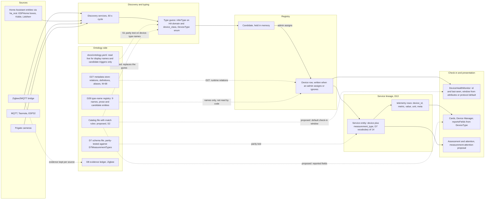

# Device add and check-in: relationship diagram assembled from existing decisions

Drafted by Code on 2026-11-15 at the owner's request, for the owner to mark up. **Assembled only from what is on `main`** (decisions D1, D7, D8, D13, D27, D28, the measurement-attention proposal, the code, and the live cabin hub on 2026-11-14). It is not a new design and it decides nothing.

**Known limit.** The owner says deeper relationship research likely exists elsewhere, locally and possibly in the cloud (Cowork or claude.ai chats). Code searched `main`, the Drive working folder, a second local clone and the cabin hub checkout for design and ontology material that is not on `main`, and found none. Anything that lives only in a chat is not reflected here. Where this diagram and that research disagree, the research wins and this file should be corrected.

## 1. The flow today, with the ontology's reach marked

Solid arrows are what the code does today. Dotted arrows are an ontology relationship that is either partial, proposed, or only a test.

## 2. Each arrow, its governing decision, and whether it is ruled

| Arrow | In | Out | Governing record | State today | Ruled? |
|---|---|---|---|---|---|
| Sources to discovery | Entities from Z2M, HA, MQTT, Frigate | Discovered entity with raw attributes | D8 (Zigbee catalog and evidence), D13 A1 (Zigbee device is parent of its HA entities) | Built | Yes |
| Discovery to type | Raw attributes | A `DeviceType` | D27 problem statement names it as not ontology-driven | Heuristic on domain and `device_class`; generic fallback | **No: this is N1 and N2** |
| Type to candidate | Typed entity | In-memory candidate | D8: enrichment may propose, never auto-activate safety behavior | Built; candidate is memory-only for HA sources | Partly: safety rule yes, "unknown held" no (N2) |
| Candidate to device row | Admin action | `device` row with lifecycle state | Device lifecycle phases 1 to 3 | Built | Yes |
| Device to service | Device row | One service per `measurement_type` | D13 | Built for services that exist | Yes |
| Service to telemetry | Observation | `telemetry` row keyed by `device_id` | D13: observation belongs to a service | Built; no check against ontology-declared fields | **No: telemetry scoping (S6)** |
| Device to check-in | Id, last-seen | Status per device | D13 reporting-mode and liveness rule | Built; window not read from an ontology type | **No: S5 and roadmap Q6** |
| Type to display fields | `DeviceType` | `reportsFields` on every device read | D27 | Built; S1 removed the UI copy | Yes |
| Ontology yaml to code | Entity ids | Display names, candidate triggers | D27 R-OC-1 says the yaml is reconciled to a runtime store | Read live for two uses only | Partly: intent yes, mechanism open |
| D7 schema to measurement types | JSON schema | Parity result | D7, DL-2026-10-21-01 | Parity test in CI | Yes |
| Catalog to type, check-in, fields | Catalog entry | Replaces the guess | None yet | Proposed (S2) | **No: N1** |
| Metadata store to device | Relations, aliases | Runtime relations | D27 R-OC-1, W-68 | Status not verified by Code for this draft | Intent yes; build status unchecked |
| Box 3 into any of this | 27 live HA entities | Nothing recorded | D28, W-84 gate, W-157 | No device row, no ontology entry | **No: N3** |

## 3. What stays outside the ontology

Confirmed by the roadmap's answer to question 4 and not contradicted by any decision read: the registry id, the hardware address, the current location (derived from sightings), assigned room and application label, lifecycle state, and the readings themselves. Type-level facts belong in the ontology or catalog.

## 4. Gaps this diagram exposes

1. **Discovery to type has no governing rule.** This is the one arrow D27's "ontology is the imperative" does not say how to implement. N1 chooses the mechanism; N2 chooses the behavior when nothing matches.
2. **Two arrows into `device_id` skip the type entirely:** telemetry and check-in. Neither consults what the type says the device reports or how often it should check in.
3. **The ontology yaml and the Java enum describe overlapping things with a guard for one list only** (S1 added device-type names and measurement fields; it does not cover categories or entity definitions).
4. **The D27 metadata store (W-68) and the catalog (S2) overlap.** Both want to hold type-level facts. Whether one is the store for the other, or they are separate, is not ruled anywhere Code found. This is the most likely place for the deeper research to matter.
5. **Check-in for relocatable devices.** W-157 keys identity on the hardware address and derives location from sightings; check-in today keys on the device id. How they meet is not described.

## 5. Questions for the owner

1. Where does the deeper relationship research live, and can it be pasted or pointed to, so this diagram can be corrected against it?
2. Is gap 4 already settled in that research (metadata store versus catalog)?
3. Do N1, N2 and N3 stand as asked, or does the research change them?

## 6. What this is not

Not a decision, not a design approval, and not authorization for any code, schema, ontology edit or device assignment. Omission is not permission: anything not stated here stays as it was.
