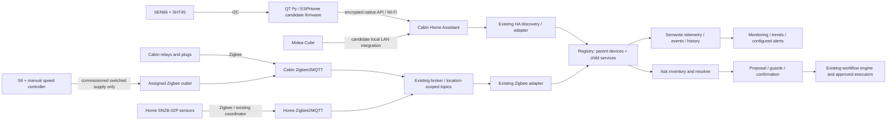

# Doc 27 — environmental monitoring and climate control

Status: ordered hardware and implementation specification; **not installed or live-verified**.
Updated 2026-10-16. Owner: Nate; collaborating implementers: Code/Codex, governance review: Cowork.
Traceability: UC-18, W-76; D1 identity, D7/D13 measurements, D23 locations, D27 metadata/actions;
POC2/W-75 remain the separate, restricted Ask demo.

## Scope and evidence

Nate confirms all Doc 27 parts are ordered. The source purchase summary is
`2026-10-15-doc27-sensor-relay-node-live-carts-built.md` (provided locally); its dated
2026-10-15 final quantities supersede earlier cart proposals. Nate subsequently confirms
the Midea Cube MAD50PS1QGR and CLOUDLINE S6 are ordered. “Air pump” means that S6,
not a second appliance. The later receipt excerpts below supersede the summary totals and give delivery estimates; receipt and installation are not verified.
Order/account identifiers are deliberately absent from this shared technical record.

This file owns build scope, purchasing, integration and commissioning. The
[master inventory](doc27-device-inventory.json) owns individual allocation records;
[ontology](../ontology.yaml) owns reusable type definitions, not serial-number instances.
[Schematics](doc27-schematics.md) own wiring boundaries; the
[Ask guide](../ai-assistant/user-guide/environmental-nodes.md) supplies reviewed-document content.

The supplied summary contains no original circuit drawing, heater/fan load nameplates,
mechanical-room terminal assignments or wire/fuse schedule. The later user clarification identifies the bathroom Air King E130S and the inter-level circulation loop. The drawings are consequently
complete functional connectivity and sensor-bus designs, **not approved mains construction
drawings**. Open engineering items are listed below rather than filled with assumptions.

## Three-node decision

| Reusable type | Human type name | Active allocation | Original reference | Function |
|---|---|---|---|---|
| `sensor_collection_box` | Sensor Collection Box | Cabin / Main level / Air quality | box 2 | Monitoring only: SEN66 + SHT45 + QT Py |
| `sensor_relay_box` | Sensor Relay Box | Cabin / Bathroom / Exhaust and heat | box 3 | Same sensing profile plus independently identified exhaust and heat controls |
| `sensor_relay_box` | Sensor Relay Box | Cabin / Mechanical room / Climate control | box 4 | Same sensing profile plus active controls; final load allocation still needed |
| `sensor_collection_box` | Sensor Collection Box | Cabin / Lower level / Air quality | box 1 | Deferred; no fourth sensor set purchased |

The two control nodes are retained intact, not redundant monitoring nodes. Inter-level
circulation is the user's reason to accept one general monitoring zone for now; it is
not proof that lower-level temperature, RH, particles or CO2 equal main-level readings.
Do not impute missing lower-level readings or claim whole-building hazard coverage.
Existing circulation is user-reported; the newly ordered S6 has not been commissioned.

## Products inbound and materials on hand

| Product / model | Purchased quantity | Allocation / status |
|---|---:|---|
| Sensirion SEN66-SIN-T | 3 | One per active node |
| SEN5X 6-pin JST GHR-06V-S cable set | 3 | SEN66-to-breakout; verify keyed pin mapping before power |
| Mean Well IRM-05-5, 5 V / 1 A module | 2 | Planned control-node supplies; enclosure and mains design not yet signed off |
| Adafruit STEMMA QT/Qwiic 100 mm cable, PID 4210 | 9 | Three budgeted per node; unused runs remain spare |
| Adafruit SHT45 breakout with PTFE, PID 6174 | 3 | One per active node, ambient T/RH reference |
| Adafruit SEN6x breakout, PID 6331 | 3 | One per active node |
| Adafruit QT Py ESP32-S3, PID 5426 | 3 | 8 MB flash/no PSRAM SKU; one per active node |
| Acrylic rod, 5 mm × 12 in | 20 rods (one pack) | Status light pipes; at least three used |
| IEC C14 inlet with fuse/switch | 3 (one pack) | Unassigned until enclosure/load review; not assumed suitably rated for every load |
| Otdorpatio IP65 ABS project box | 1 | Assign during enclosure layout; drilled vents invalidate an unqualified IP65 claim |
| SONOFF S61SZBTPB Zigbee smart plug | 2 | Unassigned Cabin outlets; one is an alternative circulation path if relay installation is unsuitable, never a second series controller |
| SONOFF MINI-ZB1GSP power-monitoring relay | 4 | Bathroom exhaust + heat; mechanical-room circulation + reserved channel; load/terminal commissioning required |
| SONOFF SNZB-02P T/RH sensor | 6 (three 2-packs) | Five Home rooms plus Cabin lower-duct reference (reallocates the previously planned spare) |
| Leviton 1451-2W, 15 A toggle | 2 | Bathroom local controls; manufacturer-approved relay switch-input topology to be confirmed |
| Midea Cube MAD50PS1QGR | 1 | Cabin dehumidification; exact room/drain route pending |
| AC Infinity CLOUDLINE S6, 6 in, supplied speed controller | 1 | Fixed inter-level loop: lower air upstairs, upper air returns downstairs; mount/service access still to mark |
| Adafruit PCB coaster, PID 5719 | 1, $0.00 | Promotional non-system accessory, no service/ontology capability |
| Carlon boxes, blank covers, cords, mesh | On hand; quantities uncounted | Inspect, assign and record adequacy before assembly |
| Home SMLIGHT SLZB-MR5U coordinator; existing leak alarms | On hand, per user/source | No new coordinator or leak sensors purchased; verify live bridge independently |

Corrected receipt totals (user supplied 2026-10-16):

| Vendor | Subtotal | Tariff | Shipping | Tax | Total |
|---|---:|---:|---:|---:|---:|
| Adafruit | $100.05 | — | $9.89 | $9.92 | **$119.86** |
| DigiKey | $218.36 | $86.73 estimated | $8.49 | $28.30 | **$341.88** |
| Amazon, two orders | Not fully itemized | — | Not separated | Not separated | **$98.19 + $147.44** |
| Home Depot toggles | Earlier summary | — | — | Not separated | **$1.70** |
| Accounted-for Doc 27 total | | | | | **$709.07** |

This supersedes the preliminary $660.96: that omitted $19.81 Adafruit shipping/tax
and $28.30 DigiKey tax. Midea and S6 prices remain excluded because not supplied.
The $98.19 Amazon and $1.70 toggle totals are carried from the earlier source;
the latest excerpts confirm $147.44 for the second Amazon order. DigiKey tariff
lines total $68.32 + $13.68 + $4.73 = $86.73, still labeled estimated on the PO.
Amazon receipt estimates: relays/rods Sunday **2026-10-18**; inlet pack, six T/RH
sensors, two plugs and enclosure **2026-10-16, 10 AM–3 PM**. These are estimates,
not receipt evidence. No order IDs, addresses, payment or tracking links are committed.
Adafruit line extensions total $100.05; DigiKey listed parts total $218.36. Amazon cabin line extensions total $134.67
and Home sensors $89.70, or $224.37 combined; the $21.26 difference from charged
Amazon totals is unitemized in the source, not assumed to be tax. The toggle line's
quantity/price basis is also unclear; retain the reported vendor total without
inventing a reconciled receipt. Tariff assertions are historical source claims,
not independently verified procurement advice.

## Identity and inherited names

Follow existing `display_name`, `location_context`, `hub_location` and D1 rather
than making a room name an immutable identity. The type key is snake_case and stable;
the exact human type label prefixes the UI name. Proposed name rendering:

- Technical alias: `<type_key>_<hub_location_slug>_<room_slug>_<purpose_slug>`.
  Example: `sensor_collection_box_cabin_main_level_air_quality`.
- UI: `<Human Type Name> — <Hub location> / <Room> / <Purpose>`.
  Example: **Sensor Collection Box — Cabin / Main level / Air quality**.
- The user's `SensorCollectionBox_Basement_HVAC` is a useful display alias; snake_case
  matches ontology IDs and including the hub avoids Home/Cabin collisions.
- Use current room/zone/qualifier attributes; keep purpose/function separately.
  If two instances share all descriptors, add a stable short hardware-identity suffix
  after enrollment, not “box 1/2” as the type. The inventory's temporary allocation
  key is not an HA entity ID, MAC, IEEE address or minted platform `deviceId`.
- Preserve immutable `deviceId`/hardware identity and HA unique IDs when location or
  purpose changes; regenerate display aliases only. ESPHome hostnames are separate
  lowercase/hyphenated protocol names validated for that platform's length limits.
- Child names inherit their parent plus sensor/source or channel, for example
  **Sensor Relay Box — Cabin / Bathroom / Exhaust and heat — SHT45 humidity**.
  Keep standalone relays/plugs visible in the master hardware inventory even when
  their services are grouped under a physical assembly in Device Manager.

The two reusable box types share the same sensor profile; `sensor_relay_box` extends
`sensor_collection_box` semantically with control associations. Hardware association
does not make the ESP32 a relay driver: Sonoff controls have their own Zigbee path.
New ontology entries are `candidate`, not new executable DeviceType enum values.

## Services, measurements and capability model

| Type / source | Services or measurements to bind after discovery | Action capability |
|---|---|---|
| SEN66 | PM1/2.5/4/10 mass concentration (µg/m³), CO2 (ppm), VOC index, NOx index, onboard T (°C) and RH (%) | Read only |
| SHT45 | Ambient T (°C), RH (%) with sensor-source provenance | Read only; prefer as ambient reference only after enclosure comparison |
| QT Py | Availability, observation time, uptime, firmware version, signal diagnostics, status LED | Maintenance only; no room-actuation capability |
| MINI-ZB1GSP | Actual exposed switch state, power W, current A, voltage V, energy kWh; availability | On/off only when commissioned and load-approved; no dimming |
| S61SZBTPB | Verify actual converter exposes, model string and ratings on arrival | Candidate on/off; energy channels only if discovered |
| SNZB-02P | Temperature, RH, battery/link/availability as actually exposed | Read only |
| Midea Cube | Candidate humidity reading, target RH, on/off, mode/fan and bucket/pump diagnostics **only if this unit exposes them** | Dehumidification control through verified HA entities; do not invent pump or drain-state services |
| CLOUDLINE S6 | Manual speed now; candidate outlet power/state, later supported UIS speed/state | Commissioned outlet on/off initially; network speed remains unavailable without a compatible controller/bridge |

SEN66 is not a CO, oxygen, radon, mold or smoke-alarm sensor. VOC/NOx indexes are
dimensionless indexes, not ppm concentrations or a universal AQI. Keep SEN66 and
SHT45 temperature/RH channels distinct; never overwrite one with the other.
Derived dew point/absolute humidity or mold-risk indicators require explicit formulas,
input provenance and separately reviewed thresholds; they are not directly sensed facts.

Doc 27's “no CO2 support” note is stale: current `HomeAssistantDiscoveryService`
maps `carbon_dioxide` to `CO2_SENSOR` and normalizes `co2`; existing Kidde documentation
also describes CO2 charting. Still audit D7/D13 measurement vocabulary, SEN66 discovery,
PM/index typing, aggregation, Grafana and UI end to end. Do not relabel CO2 as CO or
rely on a units-only ppm inference to distinguish them.

## Relationships and multi-purpose circulation

Use D27's semantic relations as the target model, preserving the existing YAML
`relationships` representation. Do not silently migrate legacy `related_to` edges
or the YAML's supplemental `relates_to` map; W-68 owns runtime reconciliation.

| Relation | Meaning here | Example |
|---|---|---|
| `located_in` | Physical installation, one current hub/room context | S6 mounted in its recorded duct location |
| `part_of` | Structural ownership; one parent, cycle-free, same hub | SHT45 service part of sensor-node parent |
| `relates_to` | Symmetric association, **no control authority or proof of effect** | S6 related to heating, cooling, humidity and climate |
| `topic_of` | Membership in a human-defined concern grouping | S6 in Climate and Humidity views |
| `subject_of` | Governed eligibility for a concept's action option | S6 associated with an approved air-mixing ask after commissioning |

Every proposed edge needs subject, predicate, object, human definition, provenance,
status and reviewer. A physical `located_in` relationship is not the air-service area;
record upstream/downstream rooms and verified affected spaces as application metadata.
An association with heating/cooling does not grant `set_temperature`; humidity
association does not mean a fan removes moisture. Mixing redistributes air; extraction
or dehumidification changes moisture under particular conditions. No inference of
fresh-air ventilation or CO2 removal from recirculation alone.

## Integration and application architecture

Select ESPHome's maintained SEN6x/SHT4x components as the firmware starting point;
pin and compile a compatible release before flashing. Prefer native encrypted API
to cabin HA, then existing discovery/normalization rather than a new bridge service.
If a missing discovery domain or measurement blocks this, fix it centrally with
tests. Do not create duplicate native-MQTT and HA parent records by fuzzy name matching.
Hardware identity/protocol provenance drives deduplication.

Home sensors join the **existing Home** coordinator/bridge, not the cabin mesh;
central M920q hosting does not change their `hub_location`. Discover the configured
bridge prefixes rather than guessing `zigbee2mqtt` for every location. Keep direct
MQTT fallbacks within the existing [topic contract](../../cabin-orchestration-platform/docs/device-topic-contract.md).

### Midea integration decision

Use the maintained community Midea AC LAN integration as the candidate local-control
path, after exact-model discovery. Wi-Fi connectivity is not the Wi-Fi Direct protocol
and is not proof of HA compatibility. LAN control may require vendor-account/cloud
token provisioning; enter credentials only in HA/approved secret storage. Reserve
the appliance's IP, confirm type/model/firmware, enumerate real entities and test local
state/control during WAN loss. Keep the dehumidifier continuously powered and use its
own humidity/compressor protections, not thermostat-style smart-plug power cycling.
Confirm gravity/pump drain arrangement, bucket-full protection and restart behavior
before unattended operation. Exact MAD50PS1QGR support remains an arrival test.

### CLOUDLINE control decision

For ordered hardware, retain the supplied speed controller and select a fixed,
commissioned mixing speed. Selected remote-control design is mechanical-room relay A for on/off, **only after** motor-load rating and restart tests. One purchased Zigbee outlet is the fallback if a suitable relay installation cannot be made; select one power-control path, not both in series. Until
then it is manual-only. An unused relay is not assumed a motor speed controller.
The manufacturer's PWM motor description is not a documented ESP32 pinout.

For future variable speed, the documented HA community integration uses a supported
Wi-Fi UIS controller (for example Controller 69 Pro) and the UIS cloud. No such
controller is in the ordered BOM. Treat it as an optional procurement/design gap,
not an inbound product or local-only integration. Verify the shipped S6 connector
revision/controller compatibility before selecting it. Keep desired/commanded speed,
reported level and actual airflow distinct; no airflow sensor was ordered.

### Workflow ownership and use cases

User-authored plans belong to `WorkflowRuleService` (D27). Existing cabin leak/freeze/
siren automations remain HA-owned. Do not give HA and the platform competing comfort
setpoint loops; preserve appliance protections. New class/guard/store work remains
W-45/W-68/W-69/W-71, not implied complete by these documents.

| Use case | Inputs | Intended response / evidence |
|---|---|---|
| General air-quality monitoring | Main-level PM, CO2, indexes and T/RH | Trends and configured alerts with timestamps/source; no lower-level equivalence claim |
| Bathroom moisture and comfort | Local T/RH plus exhaust/heat state | Separate, guarded exhaust and heat proposals; load/interlock review before automation |
| Mechanical-room condition monitoring and control | Local sensor set plus assigned control channels | Independent channels retained; no invented load mapping |
| Dehumidification | Midea readings plus independent RH reference | Reviewable target-RH control and drain/bucket diagnostics where supported |
| Multi-level air normalization | Room T/RH plus S6 state | Commissioned circulation; compare effects before claiming heating/cooling/humidity benefit |
| Home equipment-area monitoring | Five SNZB-02P room sensors | Per-room T/RH history; existing leak alarms remain separate direct leak evidence |
| Ask explanation and later proposals | Reviewed docs + live authorized inventory | Explain capabilities now; never claim ordered devices are online; no new action scope for POC2 |

## Year-round inter-level circulation loop

Nate's 2026-10-16 clarification supersedes any earlier seasonal/reversing-fan
interpretation: the **same fixed loop** supports summer and winter. The driven leg
moves lower-level air upstairs; a separate return-air path brings upper-level air
downstairs. These are simultaneous parts of one loop, not a motor-reversing command.
The S6's actual duct/mount location remains to be marked. Recirculation moves sensible
heat and moisture; it is not outdoor ventilation or a dehumidifier.

Two real measurement points drive demand:

| Point | Placement and source | Allocation decision |
|---|---|---|
| Upper reference | Top of the upstairs zone; SHT45 from the main-level monitoring node | Mount that node so the temperature source represents the stated upper point, clear of electronics heat |
| Lower reference | Central basement duct point, **72 inches (6 ft) above the basement floor** | Use the sixth SNZB-02P, previously planned as Home spare; retain five Home room sensors |

No fourth SEN66 set is needed. The lower temperature-only sensor is not the deferred
lower-level full air-quality box and does not restore lower-level PM/CO2 coverage.
Do not move the existing mechanical-room freeze sensor to create this reference.
Keep actual sensor location separate from the spaces served by the air loop.

**Control specification for code to follow:** normalize both fresh readings to °C;
compute signed `delta_t = upper_temperature - lower_temperature` and magnitude
`abs(delta_t)`. Use magnitude for mixing demand and retain sign for explanations.
No seasonal reverse or fabricated target room temperature. Configurable start/stop
thresholds must have start > stop, with a commissioning-selected persistence interval,
minimum on/off times and maximum observation age/skew. Values are not chosen here
without measurements; store them as required commissioning configuration, not defaults
that quietly activate a rule. Battery sensor reporting cadence must support those settings.

With ordered equipment, implement demand-based **on/off at a manually selected fixed
speed**, using the native S6 controller. No relay PWM or repeated rapid power switching.
Future verified speed control may map delta bands to bounded speed levels; only expose
that operation after a supported controller is installed. Continuous minimum-speed
circulation is a separate operator-selected mode; it must not be silently substituted
for demand cycling. Manual stop overrides the comfort loop. Missing/stale/skewed
readings suspend automatic demand and show a fault; use the commissioned safe fallback,
with stopped comfort circulation as the proposed default, never stop the independent
freeze heater. Resume only with fresh matched observations and the minimum-cycle rules.

Commission by recording upper/lower temperatures before/after fan operation, duct
direction and return path, runtime/noise, pressure/door effects and competing exhaust
operation. Verify the difference actually narrows; persistence of a difference may
indicate placement/airflow limits rather than a command to increase speed indefinitely.
No energy-saving or uniform-temperature claim until measured. Save this as a governed
platform workflow after authorization; it remains outside W-75's heater-only exception.

### Bathroom and mechanical-room load decisions

Bathroom exhaust is **Air King E130S** (Nate confirmed). Manufacturer specification:
115/120 V, 60 Hz; published maximum 37 W and 0.3 A; 6-inch duct. Confirm the actual
nameplate and installed wiring before sizing. This is an exhaust fan, not the separate
heat load. Nate describes the other in-wall unit as nominal “110” and no more than
a toaster; that description does not establish its exact motor/heater classification,
wattage or ampacity. Keep the heat-channel purpose from Doc 27, but confirm the unit's
nameplate/function before connecting. Do not convert the analogy into a 15/16 A rating.

Mechanical-room relay A is assigned to the **S6 circulation supply**, subject to load
verification; relay B is **reserved, not connected**. Existing repository evidence
already identifies `zigbee_heater_mech_room` as a controlled freeze heater and
`zigbee_main_water_valve` as a valve actuator. Preserve both paths. The repository's
water-heater switch is only a candidate with unknown actual load: do not assign a
purchased relay to that potentially different-voltage/high-current circuit by inference.
The mechanical-room box therefore remains an active-control node without duplicating
freeze protection. The “next 14 days” file was not recovered from the searched repo,
local summary or available chat/Drive results; this decision is based on Nate's current
description and the cited existing ontology, not invented recollection.

The purchased C14 inlet is listed **10 A / 250 V**. Its limit does not become 16 A
because a downstream relay advertises 16 A. Restrict the provisional inlet design to
the reviewed node power supply; do not route unknown heater/aggregate loads through it.
Final branch protection, motor rating, conductor schedule and enclosure review remain
required before energizing mains wiring.

Source: [Air King E130S specification](https://www.airkinglimited.com/wp-content/uploads/2020/09/E130SSpec.pdf),
user receipt/model clarification, and the existing heater/valve entries in
[ontology](../ontology.yaml).

## Setup, maintenance and acceptance

1. Receive and match SKU/revision/count against inventory; record serial/IEEE identity
   securely, receipt state and photographs. Do not create fake discovery IDs.
2. Bench-build the low-voltage sensor profile, scan I2C, confirm all channels and
   separately record SEN66/SHT45 T/RH. Pin firmware, measure supply peaks, uptime,
   thermal bias and reconnect behavior before assembling control enclosures.
3. Complete mains/load design in [schematics](doc27-schematics.md). Preserve existing
   manual controls and independent thermal limits; commission exhaust and heat separately.
4. Enroll each device in its correct hub, then bind child services by actual hardware
   parent; prove parent-device counts exclude duplicate HA/Z2M representations.
5. Verify normal/missing/stale/offline values in HA/Z2M, backend semantic keys,
   history/aggregation, Monitoring, Grafana and Ask inventory. No unavailable→zero
   conversion; freshness is based on recent observations, not retained online status.
6. Start read-only. For each approved control test manual operation, observed state,
   reconnect/power recovery and denial/confirmation. Keep uncommissioned controls
   blocked, with reason, rather than show an apparently working button.
7. Compare ambient sensor readings after enclosure warmup and circulation on/off;
   record firmware/calibration/source/time. Keep ingress/mesh clear, inspect dust and
   moisture, check sensor availability after maintenance, and follow manufacturer
   cleaning intervals. Clean dehumidifier filter/drain and S6 blades per their manuals.
8. Document field failures and changes in MAINTENANCE; preserve previous config for
   rollback. Disable the affected comfort rule/control if verification fails; do not
   disable unrelated safety automations. Re-run type inference/normalization and UI
   tests when an integration update changes exposed services.

Acceptance evidence must include inventory reconciliation, sensor-channel/unit map,
parent/service uniqueness, cross-hub denial, stale-data behavior, hardware restart
tests, UI/history screenshots and exact observed controls. Firmware compile alone
does not establish safe wiring, sensing accuracy or live integration.

## Open engineering inputs and code handoff

- Circulation relay and bathroom heater nameplates, supply voltage,
  breaker/GFCI arrangement, enclosure space, terminal revision and conductor/fuse
  schedule are not present in the supplied summary. Obtain before final mains drawing.
- Current design allocation: bathroom exhaust and heat, mechanical-room circulation and one reserved relay. This is a new explicit design decision using Nate's clarification, not a claim to have recovered the missing earlier winter-plan file.
- Both smart plugs remain unassigned; one may substitute for circulation relay A after rating checks. Finalize Midea location/drain, S6 mounting/service access and the physical return-air path.
- Inventory existing boxes/cords and the sensor-only node's suitable USB supply;
  missing fuses/terminals/strain reliefs/diodes are unresolved materials, not ordered.
- Code phases: (a) reviewed schemas/type relations/naming preview; (b) pinned firmware
  and read-only telemetry; (c) service discovery/normalization/UI parity; (d) guard and
  workflow integration; (e) verified Ask routing/evaluation. Each phase adds relevant
  regression and denial tests and links its PR to W-76. No runtime implementation is
  included in this preparation PR, and no production device/config is changed.

## Verified technical references

Checked 2026-10-16; confirm delivered revisions before wiring or installing.

- [Sensirion SEN66](https://sensirion.com/products/catalog/SEN66) — channel identity and sensor electrical specification.
- [Adafruit SEN6x pinout](https://learn.adafruit.com/adafruit-sen6x-breakout/pinouts) and [QT Py S3 pinout](https://learn.adafruit.com/adafruit-qt-py-esp32-s3/pinouts) — connector, bus and power boundaries.
- [ESPHome SEN6x](https://esphome.io/components/sensor/sen6x/) and [SHT4x](https://esphome.io/components/sensor/sht4x/) — maintained firmware components; not a deployed firmware claim.
- [Zigbee2MQTT MINI-ZB1GSP](https://www.zigbee2mqtt.io/devices/MINI-ZB1GSP.html) — converter exposes; validate installed converter version.
- [Midea AC LAN](https://github.com/wuwentao/midea_ac_lan) — candidate integration and cloud-assisted provisioning caveat.
- [AC Infinity S6](https://acinfinity.com/cloudline-s6-quiet-inline-fan-6-with-speed-controller/) — supplied controller and UIS compatibility; page includes mixed controller copy, so verify shipped bundle.
- [AC Infinity HA integration](https://github.com/dalinicus/homeassistant-acinfinity) — supported Wi-Fi UIS controllers and cloud dependency.
