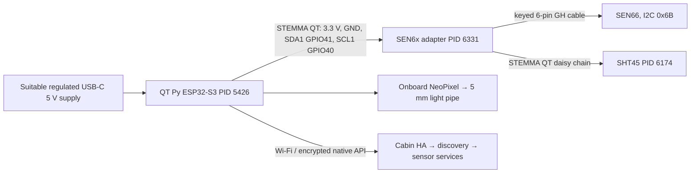
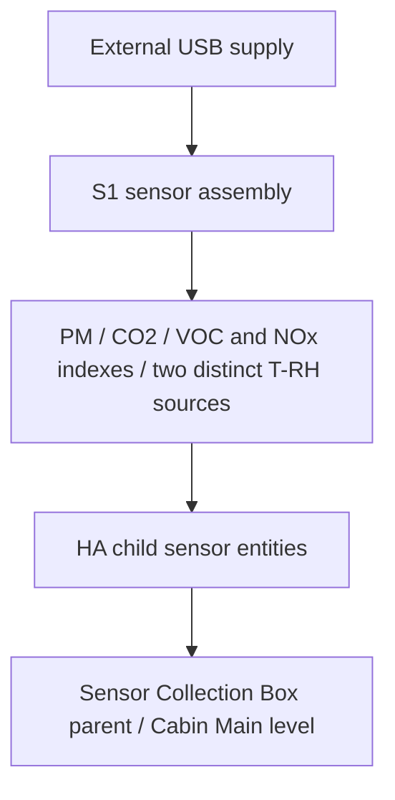
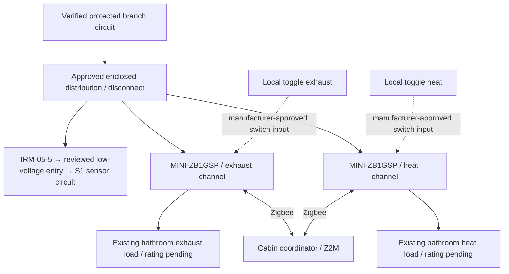
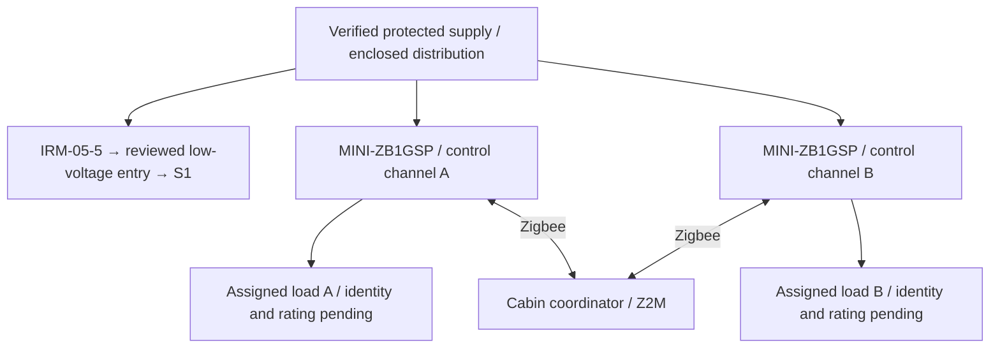
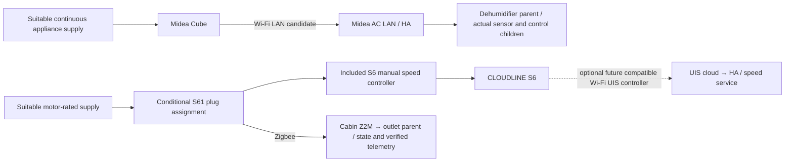
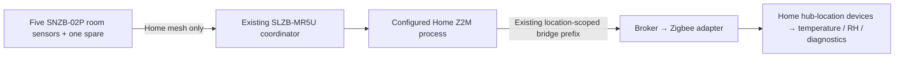

# Doc 27 — device and service schematics

Design basis: [build plan](doc27-environmental-nodes.md). Status: low-voltage and
functional drawings for review; mains terminal schedule not approved. All three
active nodes use the same sensor circuit. Bathroom and mechanical-room control
channels remain independent of the ESP32 and of each other.

## S1 — shared sensor circuit

| Net | Connection | Verification |
|---|---|---|
| Low-voltage power | Regulated USB-C supply → QT Py USB-C | Bench USB-only first; suitable supply still to be assigned |
| I2C data | QT connector SDA1/GPIO41 → adapter SDA → SHT45 SDA | Do not substitute the separate edge-pad I2C pins |
| I2C clock | QT connector SCL1/GPIO40 → adapter SCL → SHT45 SCL | Same bus for both sensors; inspect assembled cable polarity |
| Sensor-board supply | QT connector 3.3 V → adapter VIN and SHT45 VIN | Verify total regulator/startup budget and delivered breakout revision |
| Reference | QT GND → both breakout GND | Low-voltage reference only; never relay mains/switch inputs |
| SEN66 | Adapter's GH connector → SEN66 through ordered keyed cable | Match connector pin numbering, not wire colors; no raw 5 V injection into sensor |
| Ambient T/RH | SHT45 mounted clear of PSU/MCU and exhaust heat | Compare against SEN66 before choosing authoritative ambient channels |
| Indication | Onboard NeoPixel → acrylic light pipe | Firmware must distinguish boot, connected, sensor fault and unavailable, not just power-on |

The SEN66's specified supply range is 3.15–3.6 V; it is not a 5 V sensor.
The adapter supplies the sensor interface; do not infer SEN5x electrical compatibility
from the purchased cable's name. Confirm a scan sees SEN66 at 0x6B and the SHT45
address from its delivered board/driver. Measure worst-case sensor fan startup plus
Wi-Fi load; the QT Py regulator's peak rating is not a guaranteed continuous budget.
If insufficient, design a separate regulated sensor supply with correct logic levels
and no backfeed before assembly; that extra supply is not in the purchased BOM.

For the two IRM-powered nodes, select **one** supported external-power entry per
Adafruit's schematic. The 5 V pad requires the documented series-diode arrangement;
the rear BAT/GND pads have a different protected input path. Neither is interchangeable
with direct raw sensor power. Do not connect USB and an improvised external supply
until the final power design has been reviewed. Diode/connector choices and current
budget remain in the engineering schedule, not assumed present among ordered parts.

Keep sensor inlets/outlets open with appropriate placement and mesh, separated from
line-voltage compartments and heat sources. Drilling a rated sealed box changes its
ingress protection. Do not place sensors in a condensation path or seal the SEN66 fan.

Sources: [SEN66 specification](https://sensirion.com/products/catalog/SEN66),
[adapter](https://learn.adafruit.com/adafruit-sen6x-breakout/pinouts),
[QT Py power/bus](https://learn.adafruit.com/adafruit-qt-py-esp32-s3/pinouts).

## S2 — monitoring-only type

No relay, load or command channel. The deferred lower-level type would reuse this
design; no firmware instance or registry identity is created for that deferred node.

## S3 — bathroom control type (functional, not terminal wiring)

A local switch input is not a bypass or a fail-safe disconnect. Do not wire mains or
Sonoff switch terminals to ESP GPIO. Keep the original heater thermal protection,
exhaust requirements and manual operation; no software assumption replaces them.
Confirm load current/inrush, relay motor/resistive ratings, actual terminal diagram,
neutral/earth continuity, overcurrent protection, separation and enclosure suitability
with the installer before turning this diagram into a construction drawing.

## S4 — mechanical-room control type (functional, not terminal wiring)

The two relay allocations are proposed from the four purchased relays; confirm
against the original detailed Doc 27 design. Do not equate a new relay with the
existing W-75 mech-room heater entity. Do not assign the Midea compressor to a
relay merely because it is nearby. Unassigned channels are blocked in control metadata.

## S5 — appliance connectivity and service parents

Plug state means power was commanded/reported, not measured airflow. Duct layout
must identify intake, discharge, mounting, service access and affected rooms. The S6
does not become an exhaust/CO2 removal system merely by mixing indoor air.
Keep Midea drainage/bucket protections operational and verify its delivered model's
pump mode before relying on drainage. No networked UIS controller was ordered.

## S6 — Home T/RH path

No direct leak detection is inferred from T/RH. The coordinator does not transport
camera video; the purchase note's camera/coordinator wording is not a verified network
topology. Reuse the actual Home integration configuration after read-only inspection.

## Final construction schedule — required evidence

Before any mains assembly, fill in: exact load models and ratings; circuit voltage
and protection; relay revision and manufacturer terminal diagram; conductor sizes;
fuse choices; earthing/strain relief; enclosure compartment layout; local-switch
behavior; heat/exhaust interlocks; power-loss recovery; measured low-voltage budget.
Have the installer approve that completed drawing. The present documents cannot
truthfully supply these details from the order summary alone.
